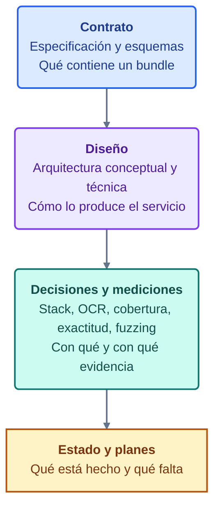

# Documentación del microservicio OKF

**Qué hace el servicio, cómo lo hace y por qué se hizo así.**

Esta carpeta explica el resultado que entrega el microservicio (un bundle OKF), el comportamiento del servicio y las herramientas elegidas. Si llegas por primera vez, empieza por la [guía visual del repositorio](../README.md): explica qué recibe el servicio, qué entrega, cómo funciona y cómo desplegarlo. Para convertir tu primer archivo desde el navegador, ve a [Probar los endpoints con Swagger UI](../README.md#probar-los-endpoints-con-swagger-ui).

## Por dónde empezar

Elige según lo que necesites.

| Si quieres... | Lee primero | Después |
| --- | --- | --- |
| Probar el servicio | [Guía visual del repositorio](../README.md) | [Estado del proyecto](estado/ESTADO_DEL_PROYECTO.md), para saber qué esperar de cada formato |
| Saber exactamente qué contiene un bundle | [Especificación OKF documental](especificacion/ESPECIFICACION_OKF.md) | [Esquema del frontmatter](especificacion/perfil-1.25.0.schema.json), para comprobarlo con una máquina |
| Leer los bundles desde un sistema RAG | [Especificación, §2 y §3](especificacion/ESPECIFICACION_OKF.md) (identidad, procedencia y citas) | [Plan 3](planes/PLAN_3_CONTRATO_DE_SALIDA_PARA_RAG.md), que explica por qué existe cada campo |
| Entender cómo está diseñado | [Arquitectura conceptual](arquitectura/ARQUITECTURA_CONCEPTUAL_MICROSERVICIO_OKF.md) | [Arquitectura técnica](arquitectura/ARQUITECTURA_TECNICA_MICROSERVICIO_OKF.md) |
| Saber por qué se eligió una biblioteca o un método | [Stack tecnológico](decisiones/STACK_TECNOLOGICO_MICROSERVICIO_OKF.md) | Las [decisiones y mediciones](#decisiones-y-mediciones) |
| Saber cómo va el proyecto y qué falta | [Estado del proyecto](estado/ESTADO_DEL_PROYECTO.md) | Los [planes](#estado-y-planes) |
| Cambiar el código | [Instrucciones para agentes](../AGENTS.md) (verificación y reglas de documentación) | El documento que regula la parte que vas a tocar |

## Mapa de la documentación

La documentación tiene cuatro capas. Las de arriba mandan sobre las de abajo.

### Contrato

| Documento | Qué resuelve |
| --- | --- |
| [Especificación OKF documental](especificacion/ESPECIFICACION_OKF.md) | Archivos, frontmatter, recursos, procedencia, reglas por formato y validación, con el registro de cambios de cada versión del perfil. |
| [Especificación propuesta del microservicio de segmentación para RAG](especificacion/SEGMENTACION_PARA_RAG.md) | Contrato del consumidor de bundles OKF, fragmentos citables por formato y criterios de aceptación del primer MVP. |
| [Esquema del frontmatter, perfil 1.25.0](especificacion/perfil-1.25.0.schema.json) | JSON Schema de los campos de `documento.md`, el informe y cada tipo de concepto, y del archivo de localizadores de bloque PDF, PPTX, DOCX y XLSX, para comprobarlos mecánicamente. La carpeta guarda el de la versión actual y los anteriores cuyo contenido difiere; los de 1.10.0 a 1.15.0 eran idénticos al 1.16.0 salvo su número, y el de 1.24.0 al de 1.25.0; siguen en el historial de Git. |
| [Esquema del frontmatter, perfil 1.23.0](especificacion/perfil-1.23.0.schema.json) | Esquema anterior compatible para los bundles ya publicados, con los localizadores de forma PPTX en el frontmatter; vale también para los perfiles 1.18.0 a 1.22.0, cuyos esquemas solo diferían en el número. |
| [Esquema del frontmatter, perfil 1.17.0](especificacion/perfil-1.17.0.schema.json) | Esquema anterior compatible para los bundles ya publicados, sin `ocr.max_images` en la configuración. |
| [Esquema del frontmatter, perfil 1.16.0](especificacion/perfil-1.16.0.schema.json) | Esquema anterior compatible para los bundles ya publicados, con los localizadores de bloque PDF en el frontmatter; vale también para los perfiles 1.10.0 a 1.15.0. |

### Diseño

| Documento | Qué resuelve |
| --- | --- |
| [Arquitectura conceptual](arquitectura/ARQUITECTURA_CONCEPTUAL_MICROSERVICIO_OKF.md) | Responsabilidades, recorrido de una conversión, modelos de lectura y de salida, y estados. Incluye el diagrama del flujo. |
| [Arquitectura técnica](arquitectura/ARQUITECTURA_TECNICA_MICROSERVICIO_OKF.md) | Dos procesos, almacenamiento local, trabajo durable, reintentos, límites y publicación; diagrama de los procesos, frontera y aislamiento del proceso de conversión (por qué no tiene red ni credenciales) y derivación de los identificadores deterministas. |
| [Arquitectura técnica propuesta del segmentador para RAG](arquitectura/ARQUITECTURA_TECNICA_SEGMENTACION_PARA_RAG.md) | Despliegue del MVP, validación del bundle, construcción de citas por formato, entrega del ZIP y operación bajo concurrencia y fallos. |

### Decisiones y mediciones

| Documento | Qué resuelve |
| --- | --- |
| [Stack tecnológico](decisiones/STACK_TECNOLOGICO_MICROSERVICIO_OKF.md) | Rust, bibliotecas, persistencia, renderizado y pruebas necesarias antes de cerrar los adaptadores. |
| [Decisión de renderizado PPTX](decisiones/RENDERIZADO_PPTX_MEDICIONES.md) | Renderizador PPTX elegido y mediciones con ejemplos sintéticos y con el corpus real. |
| [Medición de la calidad del bundle](decisiones/MEDICION_DE_CALIDAD.md) | Qué se comprueba en cada conversión y qué solo en las pruebas y las herramientas; por qué la medición está en Python y cómo llega a la CI sin Python; cómo funciona `tools/exactitud.py`, con diagramas. Léelo antes de los dos siguientes. |
| [Cobertura frente a una referencia independiente](decisiones/COBERTURA_INDEPENDIENTE.md) | Método y resultados de la comparación de cada bundle con pdfium, python-docx, python-pptx y openpyxl; hallazgos. |
| [Exactitud del texto PDF](decisiones/EXACTITUD_DEL_TEXTO.md) | Métricas de orden, orden interno, contigüidad y estructura (encabezados, listas, tablas y código) frente a referencias exactas (generadas con las muestras o revisadas a mano) o aproximadas (pdfium); borradores de referencia, comprobación en las pruebas y línea base. |
| [Fuzzing de los lectores](decisiones/FUZZING.md) | Objetivos, límites, semillas, reproducción y criterio de estabilidad nocturna. |
| [Migración a PostgreSQL](decisiones/MIGRACION_POSTGRESQL.md) | Configuración desde `.env`, concurrencia y despliegue. |
| [Compilación y empaquetado Docker](decisiones/COMPILACION_DOCKER.md) | Caché de dependencias, BuildKit local y en CI, runtime sobre `scratch` y mediciones de tamaño y reconstrucción. |
| [OCR local](decisiones/OCR_LOCAL.md) | OCR opcional de los PDF escaneados: motor y modelos elegidos, alternativas, ajustes medidos (enderezado, anchos fijos, tamaño por la tinta), exactitud, tiempo y memoria. |
| [Pruebas de calidad y carga con PDF reales](decisiones/PRUEBAS_PDF_REALES.md) | Método repetible, evaluación de texto y estructura, recursos y carga con tres PDF privados (346, 65 y 575 páginas); formularios, tablas, diagramas, capturas, listados OCR, carga sostenida y rendimiento de la conversión. Cuatro artículos de arXiv con plantillas de congreso (perfil 1.25.0). |

### Estado y planes

| Documento | Qué resuelve |
| --- | --- |
| [Estado del proyecto](estado/ESTADO_DEL_PROYECTO.md) | Qué está implementado, con qué evidencia de calidad, brechas frente a la arquitectura, comparación con el plan inicial y roadmap pendiente. |
| [Plan 1: recuperar del plan original](planes/PLAN_1_RECUPERACION_DEL_PLAN_ORIGINAL.md) | Decisiones del plan inicial que se recuperan (modelo de salida común, referencia de cobertura, imagen reproducible, límites y admisión, registro, corpus, división en capítulos, auditoría de dependencias) y las que se cierran en la documentación. |
| [Plan 2: calidad y robustez](planes/PLAN_2_CALIDAD_Y_ROBUSTEZ.md) | Regresión, entradas hostiles, operación y contrato: bundles de referencia, aislamiento, fuzzing, salud, retención y versiones. |
| [Plan 3: contrato de salida para el RAG](planes/PLAN_3_CONTRATO_DE_SALIDA_PARA_RAG.md) | Lo que faltaba del contrato que pide el pipeline RAG: identificadores de conversión y de unidad, versiones del documento, configuración usada, relaciones entre unidades, referencias no resueltas, coordenadas, permisos, texto generado y esquema del frontmatter. |
| [Plan 4: completitud y exactitud del texto](planes/PLAN_4_COMPLETITUD_Y_EXACTITUD_DEL_TEXTO.md) | Tres trabajos: referencias revisadas de originales reales y métricas de estructura, texto dentro de imágenes y escaneos largos, y defectos de maquetación residuales. |
| [Plan 5. Implementación del MVP de segmentación para RAG](planes/PLAN_5_MVP_SEGMENTACION_PARA_RAG.md) | Siete etapas con dependencias y criterios de aceptación, desde el validador compartido hasta la verificación de citas en los cuatro formatos. |

## Ejemplos por formato

Cada formato tiene su carpeta en `examples/`. Los documentos de `corpus/` son copias reducidas de originales reales (se generan con `reduce_corpus.py`), los de `muestras/` son documentos artificiales que cubren casos concretos y `esperado/` guarda el bundle de referencia de cada uno, que las pruebas comparan archivo por archivo.

| Formato | Carpeta | Qué contiene |
| --- | --- | --- |
| PPTX | `examples/pptx/` | Cuatro presentaciones mínimas y el corpus real reducido. |
| DOCX | `examples/docx/` | Dos documentos mínimos, el corpus real reducido y cuatro muestras con tablas complejas, notas, comentarios, control de cambios, ecuaciones, gráficos, contenido no representable y un documento sin estilos de encabezado ni listas reales. |
| XLSX | `examples/xlsx/` | Tres libros artificiales (`create_samples.py`): ventas con fórmulas, tabla grande, gráfico y comentarios; inventario con varias regiones, tabla dinámica y hoja de gráfico; y un libro con contenido no representable (vínculo externo, fórmulas sin valor, objeto incrustado). |
| PDF | `examples/pdf/` | Corpus real reducido (artículo científico a dos columnas, exportación de Word con marcadores y presentación de Canva), cuatro muestras (un documento breve, un artículo con tabla y figura, un informe con listas y código, y un expediente con páginas escaneada, en blanco, solo visual y mixta) y `escaneado_ocr.pdf`, el informe convertido en un escaneo para el OCR local. |

## Precedencia

Si dos documentos parecen decir cosas distintas, manda el de la capa superior:

1. La [especificación oficial de OKF v0.2](https://github.com/GoogleCloudPlatform/open-knowledge-format/blob/main/SPEC.md) y el perfil documental del proyecto rigen el bundle. El perfil añade requisitos de este conversor; no debe invalidar la especificación oficial.
2. Las arquitecturas rigen el flujo y las garantías operativas. El diagrama sirve para orientarse; si un detalle del dibujo difiere del texto, se sigue el texto.
3. El documento de stack selecciona herramientas para cumplir los contratos anteriores. Una limitación de una biblioteca no autoriza a eliminar una referencia, un recurso o una validación exigidos por el perfil.

Si encuentras una contradicción real entre documentos, registra el caso concreto y corrige primero el documento que define ese contrato; después actualiza los dependientes. No resuelvas el conflicto con una suposición silenciosa en el código.

Los documentos se enlazan con rutas relativas para que funcionen dentro del repositorio y en Obsidian.
