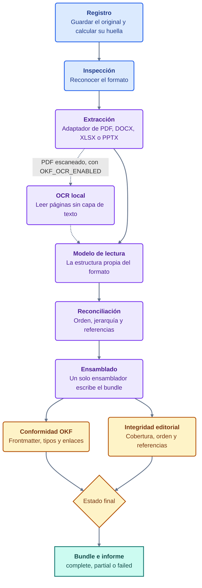
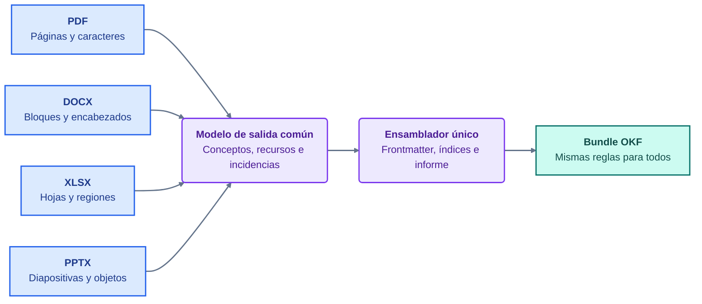
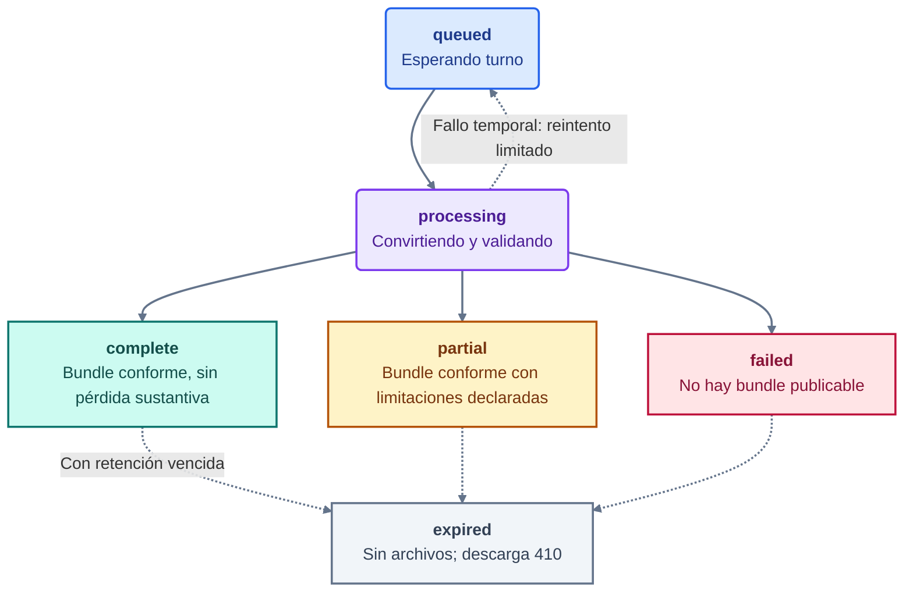

# Arquitectura conceptual del microservicio de conversión a OKF

**Qué hace el servicio, qué responsabilidades tiene y qué garantiza, sin entrar en el código.**

**Entrada:** un archivo PDF, DOCX, XLSX o PPTX.  
**Salida:** un bundle OKF v0.2 conforme al [perfil documental del proyecto](../especificacion/ESPECIFICACION_OKF.md): el texto organizado en Markdown, los recursos, el documento original y un informe de conversión.

Este documento explica el diseño de forma conceptual. Los detalles de ejecución (procesos, base de datos, límites, reintentos) están en la [arquitectura técnica](ARQUITECTURA_TECNICA_MICROSERVICIO_OKF.md).

La recepción registra el trabajo y entrega su identificador. Un worker ejecuta las etapas siguientes de forma asíncrona. Las dos validaciones son independientes y determinan el estado del resultado. El OCR local es opcional: solo actúa sobre las páginas PDF escaneadas sin capa de texto, y su texto entra en el mismo modelo de lectura que el texto digital ([OCR local](../decisiones/OCR_LOCAL.md)). Si un detalle del dibujo difiere del texto de este documento, se sigue el texto.

## 1. Frontera y contrato

El microservicio convierte **un archivo de entrada en un bundle OKF** que conserva contenido, organización, recursos y referencias verificables al original. La extracción es documental; la indexación para RAG, los embeddings, las respuestas a preguntas y la síntesis de conocimiento quedan fuera de su responsabilidad. El bundle funciona como capa de fuentes: una capa de conocimiento con conceptos sintetizados para RAG puede construirse después como consumidor independiente, citando los conceptos del bundle mediante `sources` sin modificarlos.

La interacción es **asíncrona**. Tras conservar el original y registrar el trabajo, el servicio entrega un identificador. El solicitante consulta el estado y recupera el bundle al terminar. Un **worker** ejecuta la conversión fuera de la solicitud inicial. El worker forma parte del mismo microservicio; puede comenzar con una sola instancia y no constituye otro servicio.

El archivo original, la identidad y el estado del trabajo, y el resultado se conservan de forma duradera en el entorno local. La memoria de un proceso no es la única fuente de verdad. La arquitectura no requiere servicios en la nube ni prescribe una tecnología de persistencia o de ejecución.

## 2. Flujo interno

| Etapa | Responsabilidad | Resultado |
| --- | --- | --- |
| **Registro** | Identificar el trabajo, conservar el archivo sin modificar y calcular su huella. | Original inmutable y trabajo pendiente. |
| **Inspección** | Reconocer formato y características que afectan la extracción. | Inventario inicial de unidades y necesidades de extracción. |
| **Extracción** | Aplicar el adaptador de PDF, DOCX, XLSX o PPTX. En PDF, si el OCR local está activo, las páginas escaneadas sin capa de texto se transcriben aquí, antes de la maquetación, y su texto sigue el mismo camino que el digital. | Contenido, estructura, recursos, localizadores e incidencias en el modelo de lectura del formato. |
| **Reconciliación** | Resolver orden, jerarquía, continuaciones, notas, referencias y duplicaciones con visión del documento completo. | Estructura editorial consolidada. |
| **Ensamblado** | Generar conceptos Markdown, índices, recursos, procedencia y `conversion-report.md` según el perfil OKF. | Bundle candidato. |
| **Validación y publicación** | Verificar conformidad OKF e integridad editorial por separado; publicar solo un resultado final coherente. | Bundle `complete` o `partial`, o trabajo `failed`. |

Los documentos largos pueden extraerse por partes para limitar memoria. **Las partes de procesamiento no determinan la división final del bundle**: esa división sigue capítulos y secciones, hojas y regiones, o diapositivas. La reconciliación reúne las partes antes del ensamblado.

## 3. Modelos de lectura y modelo de salida

Cada formato guarda su información de manera distinta: un PDF son páginas con caracteres posicionados, un Word son bloques y encabezados, un Excel son hojas y celdas, y un PowerPoint son diapositivas con objetos. Por eso cada adaptador lee el original con un **modelo de lectura propio de su formato**, que conserva la información que el ensamblado necesita:

- **Fuente:** referencia al original inmutable, formato y huella.
- **Unidades:** jerarquía, título y orden de documento, capítulo, sección, hoja, región o diapositiva.
- **Bloques:** párrafos, listas, tablas, figuras, notas, fórmulas y otros elementos, sin reducirlos todos a texto plano.
- **Recursos y relaciones:** archivos asociados, continuaciones, pertenencia y referencias cruzadas.
- **Localizadores:** páginas físicas y etiquetas impresas; bloques DOCX; hoja y rango A1; posición e identificador de diapositiva.
- **Incidencias:** contenido omitido, incierto, inferido o conservado únicamente como recurso visual.

Cada modelo de lectura conserva la estructura propia de su formato: el PDF parte de páginas, con caracteres posicionados que proceden del propio PDF o, en un escaneo, del OCR local ([OCR local](../decisiones/OCR_LOCAL.md)); DOCX, de bloques y encabezados; XLSX, de hojas y regiones; PPTX, de diapositivas, objetos y notas.

Todos los adaptadores entregan su resultado con los mismos tipos, el **modelo de salida común**: conceptos (ruta, tipo, título, campos propios del formato, localizadores y contenido con sus marcadores), recursos e incidencias. Un único ensamblador escribe a partir de él el frontmatter, los índices, `documento.md` y el informe, de modo que las reglas comunes del bundle se aplican en un solo sitio y no necesita interpretar nuevamente los archivos originales.

El plan inicial preveía un único modelo intermedio común antes del ensamblado. Se sustituyó por esta combinación porque los modelos de lectura ya conservaban los localizadores y unificar la salida da las mismas garantías sobre el bundle con menos cambio ([plan 1, §3](../planes/PLAN_1_RECUPERACION_DEL_PLAN_ORIGINAL.md#3-lo-que-no-se-recupera)).

## 4. Estados y garantías

Un trabajo recorre `queued → processing` y termina en `complete`, `partial` o `failed`. La validación ocurre dentro de `processing`, antes de publicar; no se registra como estado aparte.

- **`complete`:** bundle conforme y sin pérdida editorial sustantiva no resuelta.
- **`partial`:** bundle conforme con limitaciones localizadas y declaradas en el informe. El bundle se puede descargar.
- **`failed`:** no se pudo producir un bundle publicable o el trabajo no terminó.

El original y el estado sobreviven al reinicio del receptor o del worker. Un trabajo interrumpido puede retomarse desde un punto comprobable o repetirse desde el original. Los archivos en elaboración permanecen separados del bundle publicado; el resultado aparece completo en una sola transición. Repetir un trabajo no debe mezclar archivos de intentos distintos.

La **conformidad OKF** comprueba frontmatter, tipos, archivos reservados y enlaces. La **integridad editorial** comprueba cobertura, orden, recursos, ausencia de duplicaciones y resolución de las referencias al original. Una salida estructuralmente válida con pérdidas declaradas puede ser `partial`; una salida que incumple OKF no se presenta como bundle válido.

En toda la cadena se preservan los localizadores de origen. Ninguna página, bloque, región o diapositiva sustantiva se omite en silencio. Los objetos incrustados y el contenido ejecutable del archivo se tratan como datos, sin ejecutarlos para convertir el documento.

## Retención y expiración

Con retención configurada, los trabajos terminados (`complete`, `partial`, `failed`)
pasan a `expired` cuando vence el plazo desde su finalización. Se eliminan original,
intentos y bundle; se conserva el registro, y la descarga devuelve `410 Gone`.
Sin plazo configurado no se expiran. La política y la limpieza reanudable están en
la [arquitectura técnica, §5](ARQUITECTURA_TECNICA_MICROSERVICIO_OKF.md#5-implementación-en-las-entregas-pptx-docx-xlsx-y-pdf).
