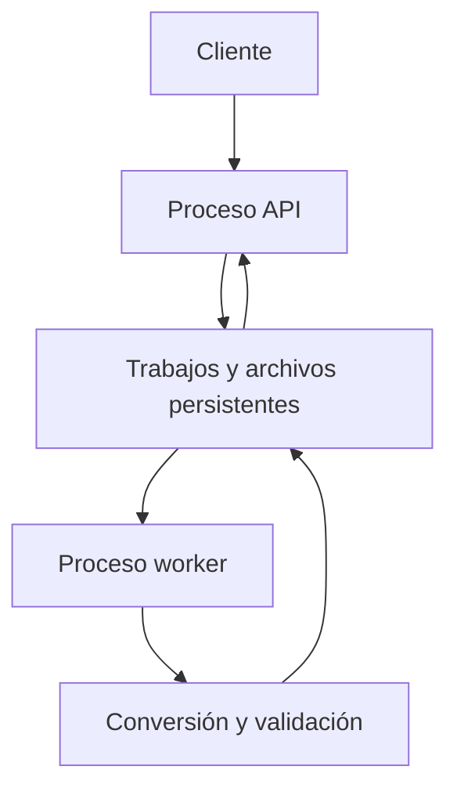

# Arquitectura técnica del microservicio OKF

**Propósito.** Convertir un archivo PDF, DOCX, XLSX o PPTX en un bundle OKF v0.2 mediante un trabajo asíncrono. Este documento define componentes y despliegue, sin elegir lenguaje, servidor, base de datos ni sistema de colas. El contenido del bundle se rige por la [especificación OKF documental](../especificacion/ESPECIFICACION_OKF.md); las etapas de conversión se describen en la [arquitectura conceptual](ARQUITECTURA_CONCEPTUAL_MICROSERVICIO_OKF.md).

## 1. Unidad de despliegue

Una instalación local del microservicio ejecuta **dos procesos del mismo sistema**: API y worker. Ambos acceden a un almacenamiento persistente local para trabajos y archivos. Se empieza con **un worker**; el registro persistente de trabajos actúa como cola durable y no exige un intermediario adicional.

El despliegue inicial ocupa un solo nodo. Si se añaden workers en ese nodo, todos deben coordinar la asignación de trabajos sobre el mismo registro. Un despliegue multinodo exige almacenamiento compartido y coordinación distribuida; queda fuera de este alcance inicial.

## 2. Componentes y responsabilidades

| Componente | Responsabilidad |
| --- | --- |
| **API** | Recibir y limitar el archivo; comprobar el formato admitido; conservar el original; registrar el trabajo; devolver su identificador; consultar estado e informe; entregar únicamente el bundle publicado. |
| **Registro de trabajos** | Mantener identidad, estado, intento, propietario temporal, vencimiento de la asignación, incidencias y referencias a los archivos. Su actualización debe impedir que dos workers reclamen el mismo trabajo vigente. |
| **Almacén de archivos** | Separar originales inmutables, áreas privadas por intento y bundles finales. Mantenerlos después de reinicios según una política de retención definida. |
| **Worker** | Reclamar trabajos, renovar su asignación, ejecutar la conversión, registrar avance, clasificar fallos, validar y publicar. |
| **Núcleo de conversión** | Inspección, adaptador por formato, modelo documental intermedio, reconciliación editorial y ensamblado OKF. Puede procesar documentos largos por partes sin convertir esas partes en conceptos finales. |
| **Validadores** | Evaluar por separado conformidad OKF e integridad editorial; producir el informe y el estado final `complete`, `partial` o `failed`. |

## 3. Ciclo de un trabajo

1. La API guarda el original sin modificar y crea un trabajo `queued`. La operación debe ser recuperable: tras una interrupción, ningún trabajo aceptado puede quedar con un original inaccesible.
2. El worker reclama de forma exclusiva el trabajo, registra un intento y procesa en un espacio privado de ese intento. Renueva periódicamente la asignación mientras trabaja.
3. Si el worker se interrumpe y vence su asignación, otro intento puede retomar desde un punto verificado o reprocesar el original. Los intentos no comparten archivos temporales.
4. El worker ensambla el bundle candidato y ejecuta ambas validaciones. Un incumplimiento de OKF impide publicarlo; las pérdidas editoriales localizadas y declaradas permiten `partial`.
5. Se publica el bundle completo mediante una operación atómica o un equivalente que impida lecturas parciales. Después se registra el estado final y su referencia. Si una interrupción separa ambos pasos, la recuperación reconcilia la referencia y el resultado sin crear dos publicaciones.

Estados: `queued → processing → complete | partial | failed`; el paso 4 ocurre dentro de `processing` y no se registra como estado aparte. `received` puede representar la recepción anterior al registro durable, pero no es un trabajo aceptado hasta conservar el original y su registro. Los reintentos son acotados y distinguen errores recuperables de errores definitivos. La consulta de estado muestra el intento vigente y, al terminar, el informe de conversión.

## 4. Reglas operativas verificables

- El identificador de trabajo permite consultar estado y descargar solo un resultado final publicado; una petición de recepción no espera a que termine la conversión.
- El original, el registro y los bundles finales sobreviven al reinicio de cualquiera de los dos procesos. No se depende de memoria de proceso para recuperar trabajos aceptados.
- La reclamación exclusiva y el vencimiento de la asignación permiten recuperar trabajos abandonados; los reintentos no duplican conceptos ni mezclan artefactos de intentos.
- Se establecen límites configurables de tamaño de entrada, trabajos simultáneos, uso de recursos y tiempo de extracción. La admisión y el worker aplican control de carga.
- Los archivos de entrada se tratan como datos no confiables: se limitan expansión y recursos, se evita ejecutar contenido incrustado y se registran errores de extracción sin omitir contenido sustantivo en silencio.
- Se conservan referencias al original y un informe de cobertura. La aceptación del resultado requiere los dos controles de calidad definidos en la especificación OKF documental.

## 5. Implementación en las entregas PPTX, DOCX, XLSX y PDF

La primera entrega implementó la ruta completa con PPTX; la segunda añadió el adaptador DOCX, la tercera el adaptador XLSX y la cuarta el adaptador PDF, todos sobre la misma cola, el mismo worker y el mismo validador.

**Conversión aislada.** El worker ejecuta cada conversión en un proceso hijo (`okf-microservice convert`, subcomando interno) y lo vigila cada 100 ms. Lo termina si su memoria residente supera el límite o si vence el plazo. La memoria se mide en `/proc` en Linux y con `ps` en otros sistemas; si no puede medirse, el worker no arranca. El límite de memoria es la garantía de recursos: el número de diapositivas no la predice, porque el consumo depende de las imágenes (ver [Decisión de renderizado PPTX](../decisiones/RENDERIZADO_PPTX_MEDICIONES.md)). Cada worker convierte un trabajo a la vez; la concurrencia se controla con el número de workers. La validación ocurre dentro de `processing`, antes de publicar, y no se registra como estado aparte.

| Variable | Predeterminado | Efecto |
| --- | ---: | --- |
| `OKF_MAX_MEMORY_MB` | 500 | Memoria residente máxima; en Linux, RLIMIT_AS limita además el espacio de direcciones a 2 × este valor + 128 MiB. |
| `OKF_MAX_OUTPUT_MB` | 512 | Tamaño máximo de cada archivo escrito por el conversor (RLIMIT_FSIZE). |
| `OKF_MAX_OPEN_FILES` | 256 | Descriptores abiertos máximos en el conversor (RLIMIT_NOFILE), mínimo 16. |
| `OKF_BUILD_COMMIT` | HEAD Git, o `unknown` sin repositorio | Solo en compilación: SHA de 40 caracteres que identifica el conversor. En Docker se pasa como `--build-arg`; la CI lo fija. |
| `OKF_FONT_PATH` | búsqueda de fuente instalada | Archivo TrueType que puede leer el renderizador PPTX, también con Landlock. |
| `OKF_MAX_SLIDES` | 300 | Diapositivas máximas por presentación. |
| `OKF_MAX_BLOCKS` | 50000 | Bloques máximos (párrafos y tablas de primer nivel) por documento DOCX. |
| `OKF_MAX_CELLS` | 1000000 | Celdas con contenido máximas por libro XLSX. |
| `OKF_MAX_PAGES` | 2000 | Páginas máximas por documento PDF. |
| `OKF_CONVERSION_TIMEOUT_S` | 300 | Duración máxima de una conversión. |
| `OKF_LEASE_S` | 60 | Vigencia de la asignación; el worker la renueva cada tercio mientras convierte. |
| `OKF_MAX_ATTEMPTS` | 3 | Intentos máximos ante fallos transitorios. |
| `OKF_RETRY_BASE_S` | 30 | Espera antes del primer reintento; se duplica en cada intento, con tope de una hora. |
| `OKF_MAX_UPLOAD_MB` | 100 | Tamaño máximo de un archivo subido, en MiB; por encima, la API responde `413`. |
| `OKF_MAX_QUEUED` | 0 | Trabajos sin terminar (`queued` o `processing`) a partir de los cuales la API responde `429`; 0 no limita. |
| `OKF_MIN_FREE_MB` | 0 | Espacio libre mínimo del volumen de datos, en MiB, por debajo del cual la API responde `507`; 0 no lo comprueba. |
| `OKF_MAX_ZIP_ENTRY_MB` | 128 | Tamaño descomprimido máximo de una parte de un paquete OOXML, en MiB. |
| `OKF_MAX_ZIP_TOTAL_MB` | 512 | Tamaño descomprimido máximo de un paquete OOXML, en MiB. |
| `OKF_MAX_ZIP_ENTRIES` | 4096 | Partes máximas de un paquete OOXML. |
| `OKF_MAX_IMAGE_PIXELS` | 33554432 | Píxeles máximos de una imagen que el conversor decodifica (imágenes PDF que no se copian como JPEG); una imagen mayor no se adjunta y se declara como pérdida. Las vistas PPTX aplican el presupuesto fijo del renderizador, que es el mismo valor, y declaran igual las imágenes omitidas. |

**Admisión.** La API comprueba la cola y el espacio libre antes de leer el archivo, y el tamaño mientras lo recibe. Los límites de los paquetes OOXML y de las imágenes se aplican en el proceso de conversión, que los recibe del worker; superar uno de los primeros es un fallo permanente.

**Límites duros y rutas (plan 2, C4).** El subcomando `convert` se ejecuta sin runtime
asíncrono y fija los límites antes de crear hilos o leer el documento: `RLIMIT_AS`
solo en Linux (memoria virtual, con margen de 2 × RSS + 128 MiB), `RLIMIT_CPU`
(plazo, mínimo un segundo de CPU, un segundo adicional de límite duro),
`RLIMIT_FSIZE`, `RLIMIT_NOFILE` y `RLIMIT_CORE=0`. Nunca eleva un límite duro
heredado. El padre mantiene el control de RSS y tiempo de pared cada 100 ms.
SIGXCPU, SIGXFSZ y un aborto con el diagnóstico de asignación de memoria rechazada
son fallos permanentes de recursos; otras señales siguen siendo transitorias.

En Linux, Landlock (ABI 3, con degradación explícita en kernels anteriores) permite
leer el original y leer/escribir solamente el directorio del intento. Permite además
leer los archivos de fuente configurados o de reserva, `/etc/localtime`; no concede ejecución ni creación de enlaces o dispositivos.
El worker registra al arrancar si Landlock no está disponible; un error al imponer
una regla impide convertir. Los descriptores estándar heredados siguen abiertos.
El contenedor del worker mantiene `network_mode: none`; Landlock aquí restringe
archivos, no sustituye ese aislamiento de red. En macOS no se aplican Landlock ni
RLIMIT_AS: la memoria se limita mediante la vigilancia de RSS.

**Registro de cada intento.** Al terminar un intento, el worker escribe una línea con el trabajo, el intento, el formato, el resultado (`complete`, `partial`, `failed`, `transient_failure` o `lease_lost`), la duración de la lectura, el ensamblado y la validación, la duración total y la memoria residente máxima. El proceso hijo devuelve su resultado como una línea JSON con las etapas, que mide el ensamblador común, y con su máximo de memoria (`getrusage` en Linux y macOS). Antes de aceptar el resultado, el worker comprueba también ese máximo y el tiempo total; así una conversión de menos de 100 ms que excede el límite no se publica. En XLSX y PDF las hojas y las páginas se leen mientras se ensamblan, de modo que su lectura cuenta como ensamblado. El registro no incluye contenido del documento.

**Asignación.** Si la renovación encuentra que el trabajo ya pertenece a otro intento, el worker termina el proceso hijo y abandona el suyo sin publicar. Antes de publicar renueva la asignación para confirmar que sigue siendo suya. El registro final solo se escribe para el intento vigente.

**Reintentos clasificados.** Un fallo permanente termina en `failed` en el primer intento: archivo inválido o dañado, límite de tamaño, diapositivas, bloques, celdas, páginas, memoria o tiempo superado, PDF protegido con contraseña, bundle que no supera la validación, o pánico del conversor. El subcomando `convert` instala un gancho que escribe el mensaje y la ubicación en stderr y sale con el código 5; el error del trabajo lo identifica como «defecto del conversor» y conserva ese diagnóstico. Un fallo transitorio vuelve a `queued` con espera creciente mientras queden intentos: errores del sistema de archivos (disco lleno, permisos, original inaccesible), un proceso hijo que termina por señal o código desconocido o un worker interrumpido cuya asignación vence. Al agotar los intentos, el trabajo termina en `failed` y el error indica cuántos se hicieron.

**Reconciliación al arrancar.** Antes de reclamar trabajos, el worker:

- elimina las publicaciones a medio hacer (`published/.<id>.tmp`);
- completa el registro de los trabajos cuyo bundle llegó a publicarse antes de una interrupción, si el bundle supera la validación, y descarta el bundle si no la supera;
- reencola los trabajos terminados cuyo bundle publicado ya no existe;
- borra los directorios de intentos de trabajos terminados o desconocidos.

La recuperación de asignaciones vencidas aplica las mismas reglas cada vez que el worker reclama un trabajo.

**Validación antes de publicar.** Además de la conformidad OKF y de los enlaces internos, el validador comprueba en todos los formatos:

- que cada `source_spans` cite una fuente declarada en `sources`;
- que cada marcador `<!-- okf-source-span: ID -->` resuelva a un `source_spans[].id` del mismo concepto y vaya seguido del bloque al que corresponde;
- que cada archivo de `assets/` esté enlazado desde algún concepto;
- que el SHA-256 del informe y de `documento.md` coincida con `references/original.<extensión>`;
- que los índices reservados distintos del raíz no lleven frontmatter.

Y según el formato del original:

- **PPTX:** un concepto por diapositiva del original, con su `slide_index` y `slide_id` en el orden de la presentación y su vista enlazada; ambos índices enumeran las diapositivas en ese orden.
- **DOCX:** los conceptos de `contenido/` reparten los bloques del original en tramos `docx_blocks` contiguos desde 1 hasta el último; cada localizador de bloque cae dentro del tramo de su concepto; `documento.md` localiza todos los bloques; ambos índices enumeran los conceptos en orden.
- **XLSX:** un concepto por hoja del original, incluidas las ocultas, con su nombre exacto y su `sheet_index` en el orden del libro; los conceptos de región pertenecen a su hoja; el localizador `hoja` coincide con el rango que ocupan las celdas con contenido, ningún otro rango sale de él y cada celda con contenido cae en alguna región; el CSV de cada región grande tiene tantas filas como su rango; ambos índices enumeran las hojas y sus regiones en orden.
- **PDF:** los conceptos de `contenido/` siguen el orden de las páginas (cada uno empieza en la página en la que termina el anterior o en la siguiente) y, con el título de `documento.md`, cubren todas las páginas del original; cada localizador `pdf_pages` cae dentro del tramo de su concepto; en un concepto de varias páginas cada bloque lleva un marcador y todo localizador se usa; `documento.md` localiza todas las páginas y `page_labels` solo tiene páginas físicas existentes con una etiqueta no vacía; ambos índices enumeran los conceptos en orden.

### Identidad de cada conversión (plan 2, C9)

`documento.md`, el informe y `GET /jobs/{id}` incluyen `converter_version`,
`converter_commit` y `profile_version`. Al reclamar se registra la versión que va a
convertir, incluso si falla; al publicar se conserva la identidad informada por el
hijo. La recuperación de una publicación interrumpida recupera la identidad del
bundle, no la del worker que reconcilia. Un trabajo aún no intentado o histórico sin
metadatos devuelve `null`. La migración SQLite conserva las bases existentes.

`build.rs` obtiene el SHA de Git al compilar o usa `OKF_BUILD_COMMIT`. Un árbol fuente
sin Git ni ese argumento registra `unknown`; no inventa un commit. Los golden fijan
solo ese campo variable como `<commit>` y siguen comparando paquete y perfil.

### Validación independiente (plan 2, C10)

`okf-microservice validate <bundle.zip | directorio>` aplica el mismo validador de
conformidad OKF e integridad editorial del servicio, leyendo el original incluido en
`references/`. Devuelve código 0 si es válido y un código distinto de cero con el
motivo en stderr si falla. No necesita SQLite ni la API.

Un directorio se copia a un ZIP temporal mediante `src/output.rs`; se rechazan enlaces
simbólicos y archivos especiales. Un ZIP se lee sin extraerlo a disco; se rechazan
rutas inseguras o duplicadas, y se verifican tamaños reales y CRC antes de validar.
Aplican los límites `OKF_MAX_ZIP_*` y los rlimits de C4. El original privado contenido
en un bundle sigue siendo parte de este: el validador no lo publica ni lo transmite.

Los árboles golden guardan huellas de binarios, no sus bytes; la prueba reconstruye
los bundles desde los 26 ejemplos y valida tanto sus ZIP como sus directorios,
además de rechazar alteraciones. Se mantienen las pruebas editoriales específicas
por formato que usan la misma función de validación.

### Búsqueda de fallos (plan 2, C5)

La [campaña de fuzzing](../decisiones/FUZZING.md) ejercita los cuatro adaptadores como biblioteca con entrada en memoria y salida temporal. El servicio mantiene el aislamiento C3/C4; los objetivos instrumentados usan los presupuestos de libFuzzer para conservar los fallos. El flujo nocturno comparte la auditoría de dependencias y conserva casos y logs.
