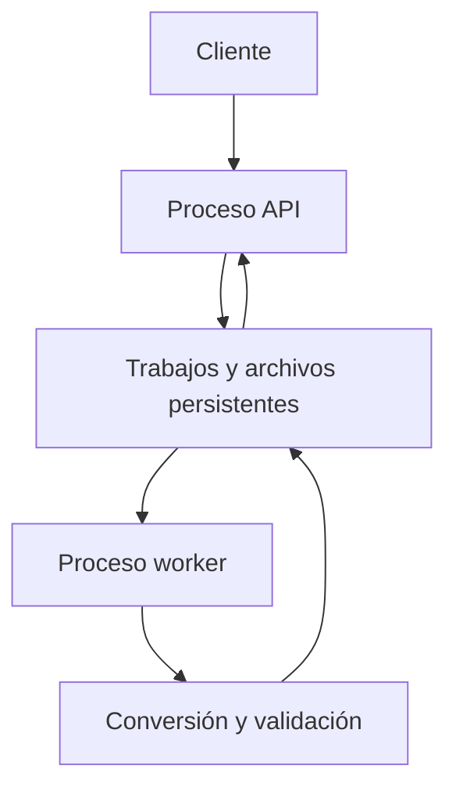

# Arquitectura técnica del microservicio OKF

**Propósito.** Convertir un archivo PDF, DOCX, XLSX o PPTX en un bundle OKF v0.2 mediante un trabajo asíncrono. Este documento define componentes y despliegue, sin elegir lenguaje, servidor, base de datos ni sistema de colas. El contenido del bundle se rige por la [especificación OKF documental](../especificacion/ESPECIFICACION_OKF.md); las etapas de conversión se describen en la [arquitectura conceptual](ARQUITECTURA_CONCEPTUAL_MICROSERVICIO_OKF.md).

## 1. Unidad de despliegue

Una instalación local del microservicio ejecuta **dos procesos del mismo sistema**: API y worker. Ambos acceden a un almacenamiento persistente local para trabajos y archivos. Se empieza con **un worker**; el registro persistente de trabajos actúa como cola durable y no exige un intermediario adicional.

El despliegue inicial ocupa un solo nodo. Si se añaden workers en ese nodo, todos deben coordinar la asignación de trabajos sobre el mismo registro. Un despliegue multinodo exige almacenamiento compartido y coordinación distribuida; queda fuera de este alcance inicial.

## 2. Componentes y responsabilidades

| Componente | Responsabilidad |
| --- | --- |
| **API** | Recibir y limitar el archivo; comprobar el formato admitido; conservar el original; registrar el trabajo; devolver su identificador; consultar estado e informe; entregar únicamente el bundle publicado. |
| **Registro de trabajos** | Mantener identidad, estado, intento, propietario temporal, vencimiento de la asignación, incidencias y referencias a los archivos. Su actualización debe impedir que dos workers reclamen el mismo trabajo vigente. |
| **Almacén de archivos** | Separar originales inmutables, áreas privadas por intento y bundles finales. Mantenerlos después de reinicios según una política de retención definida. |
| **Worker** | Reclamar trabajos, renovar su asignación, ejecutar la conversión, registrar avance, clasificar fallos, validar y publicar. |
| **Núcleo de conversión** | Inspección, adaptador por formato, modelo documental intermedio, reconciliación editorial y ensamblado OKF. Puede procesar documentos largos por partes sin convertir esas partes en conceptos finales. |
| **Validadores** | Evaluar por separado conformidad OKF e integridad editorial; producir el informe y el estado final `complete`, `partial` o `failed`. |

## 3. Ciclo de un trabajo

1. La API guarda el original sin modificar y crea un trabajo `queued`. La operación debe ser recuperable: tras una interrupción, ningún trabajo aceptado puede quedar con un original inaccesible.
2. El worker reclama de forma exclusiva el trabajo, registra un intento y procesa en un espacio privado de ese intento. Renueva periódicamente la asignación mientras trabaja.
3. Si el worker se interrumpe y vence su asignación, otro intento puede retomar desde un punto verificado o reprocesar el original. Los intentos no comparten archivos temporales.
4. El worker ensambla el bundle candidato y ejecuta ambas validaciones. Un incumplimiento de OKF impide publicarlo; las pérdidas editoriales localizadas y declaradas permiten `partial`.
5. Se publica el bundle completo mediante una operación atómica o un equivalente que impida lecturas parciales. Después se registra el estado final y su referencia. Si una interrupción separa ambos pasos, la recuperación reconcilia la referencia y el resultado sin crear dos publicaciones.

Estados: `queued → processing → validating → complete | partial | failed`. `received` puede representar la recepción anterior al registro durable, pero no es un trabajo aceptado hasta conservar el original y su registro. Los reintentos son acotados y distinguen errores recuperables de errores definitivos. La consulta de estado muestra el intento vigente y, al terminar, el informe de conversión.

## 4. Reglas operativas verificables

- El identificador de trabajo permite consultar estado y descargar solo un resultado final publicado; una petición de recepción no espera a que termine la conversión.
- El original, el registro y los bundles finales sobreviven al reinicio de cualquiera de los dos procesos. No se depende de memoria de proceso para recuperar trabajos aceptados.
- La reclamación exclusiva y el vencimiento de la asignación permiten recuperar trabajos abandonados; los reintentos no duplican conceptos ni mezclan artefactos de intentos.
- Se establecen límites configurables de tamaño de entrada, trabajos simultáneos, uso de recursos y tiempo de extracción. La admisión y el worker aplican control de carga.
- Los archivos de entrada se tratan como datos no confiables: se limitan expansión y recursos, se evita ejecutar contenido incrustado y se registran errores de extracción sin omitir contenido sustantivo en silencio.
- Se conservan referencias al original y un informe de cobertura. La aceptación del resultado requiere los dos controles de calidad definidos en la especificación OKF documental.
