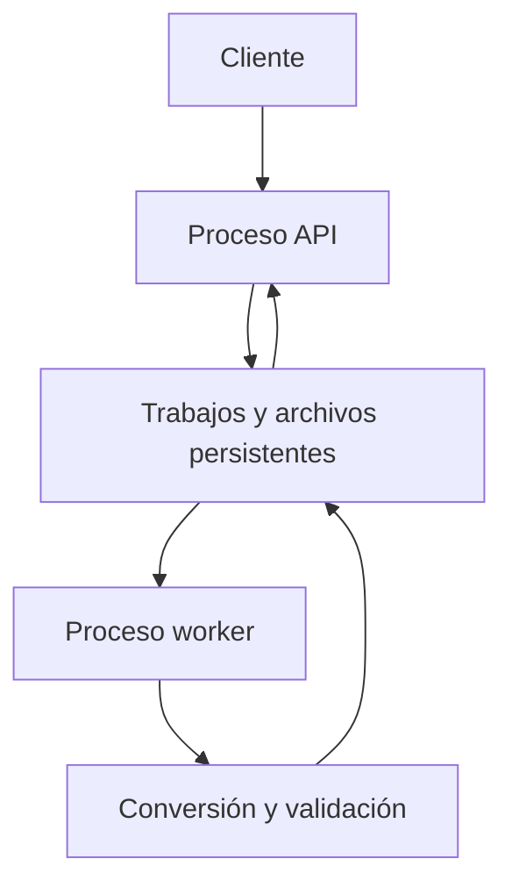

# Arquitectura técnica del microservicio OKF

**Propósito.** Convertir un archivo PDF, DOCX, XLSX o PPTX en un bundle OKF v0.2 mediante un trabajo asíncrono. Este documento define componentes y despliegue, sin elegir lenguaje, servidor, base de datos ni sistema de colas. El contenido del bundle se rige por la [especificación OKF documental](../especificacion/ESPECIFICACION_OKF.md); las etapas de conversión se describen en la [arquitectura conceptual](ARQUITECTURA_CONCEPTUAL_MICROSERVICIO_OKF.md).

## 1. Unidad de despliegue

Una instalación local del microservicio ejecuta **dos procesos del mismo sistema**: API y worker. Ambos acceden a un almacenamiento persistente local para trabajos y archivos. Se empieza con **un worker**; el registro persistente de trabajos actúa como cola durable y no exige un intermediario adicional.

El despliegue inicial ocupa un solo nodo. Si se añaden workers en ese nodo, todos deben coordinar la asignación de trabajos sobre el mismo registro. Un despliegue multinodo exige almacenamiento compartido y coordinación distribuida; queda fuera de este alcance inicial.

## 2. Componentes y responsabilidades

| Componente | Responsabilidad |
| --- | --- |
| **API** | Recibir y limitar el archivo; comprobar el formato admitido; conservar el original; registrar el trabajo; devolver su identificador; consultar estado e informe; entregar únicamente el bundle publicado. |
| **Registro de trabajos** | Mantener identidad, estado, intento, propietario temporal, vencimiento de la asignación, incidencias y referencias a los archivos. Su actualización debe impedir que dos workers reclamen el mismo trabajo vigente. |
| **Almacén de archivos** | Separar originales inmutables, áreas privadas por intento y bundles finales. Mantenerlos después de reinicios; retención optativa por `OKF_RETENTION_DAYS`, desde la finalización (§5). |
| **Worker** | Reclamar trabajos, renovar su asignación, ejecutar la conversión, registrar avance, clasificar fallos, validar y publicar. |
| **Núcleo de conversión** | Inspección, adaptador por formato, modelo documental intermedio, reconciliación editorial y ensamblado OKF. Puede procesar documentos largos por partes sin convertir esas partes en conceptos finales. |
| **Validadores** | Evaluar por separado conformidad OKF e integridad editorial; producir el informe y el estado final `complete`, `partial` o `failed`. |

## 3. Ciclo de un trabajo

1. La API guarda el original sin modificar y crea un trabajo `queued`. La operación debe ser recuperable: tras una interrupción, ningún trabajo aceptado puede quedar con un original inaccesible.
2. El worker reclama de forma exclusiva el trabajo, registra un intento y procesa en un espacio privado de ese intento. Renueva periódicamente la asignación mientras trabaja.
3. Si el worker se interrumpe y vence su asignación, otro intento puede retomar desde un punto verificado o reprocesar el original. Los intentos no comparten archivos temporales.
4. El worker ensambla el bundle candidato y ejecuta ambas validaciones. Un incumplimiento de OKF impide publicarlo; las pérdidas editoriales localizadas y declaradas permiten `partial`.
5. Se publica el bundle completo mediante una operación atómica o un equivalente que impida lecturas parciales. Después se registra el estado final y su referencia. Si una interrupción separa ambos pasos, la recuperación reconcilia la referencia y el resultado sin crear dos publicaciones.

Estados: `queued → processing → complete | partial | failed`; el paso 4 ocurre dentro de `processing` y no se registra como estado aparte. `received` puede representar la recepción anterior al registro durable, pero no es un trabajo aceptado hasta conservar el original y su registro. Los reintentos son acotados y distinguen errores recuperables de errores definitivos. La consulta de estado muestra el intento vigente y, al terminar, el informe de conversión.

## 4. Reglas operativas verificables

- El identificador de trabajo permite consultar estado y descargar solo un resultado final publicado; una petición de recepción no espera a que termine la conversión.
- El original, el registro y los bundles finales sobreviven al reinicio de cualquiera de los dos procesos. No se depende de memoria de proceso para recuperar trabajos aceptados.
- La reclamación exclusiva y el vencimiento de la asignación permiten recuperar trabajos abandonados; los reintentos no duplican conceptos ni mezclan artefactos de intentos.
- Se establecen límites configurables de tamaño de entrada, trabajos simultáneos, uso de recursos y tiempo de extracción. La admisión y el worker aplican control de carga.
- Los archivos de entrada se tratan como datos no confiables: se limitan expansión y recursos, se evita ejecutar contenido incrustado y se registran errores de extracción sin omitir contenido sustantivo en silencio.
- Se conservan referencias al original y un informe de cobertura. La aceptación del resultado requiere los dos controles de calidad definidos en la especificación OKF documental.

## 5. Implementación en las entregas PPTX, DOCX, XLSX y PDF

**Exploración y pruebas de la API.** El mismo proceso HTTP sirve Swagger UI en `GET /docs/` (`/docs` redirige allí) y su contrato OpenAPI en `GET /api-docs/openapi.json`. El contrato se genera a partir de las anotaciones de los handlers y los tipos serializados. La interfaz sirve sus recursos embebidos, sin CDN ni envío a un validador externo, y ejecuta las peticiones sobre el mismo origen, sin configurar CORS ni una segunda aplicación. No añade autenticación; conserva las condiciones de acceso del servicio. La guía de uso está en el [README](../../README.md#probar-los-endpoints-con-swagger-ui).

`OKF_SWAGGER_ENABLED` controla ambas rutas al arrancar: `true` (también si no se define) las habilita; `false` omite Swagger, todos sus recursos y el contrato OpenAPI del router, por lo que responden `404`. Un valor distinto de `true` o `false` impide arrancar con un error de configuración. Los endpoints de trabajos, salud y métricas no dependen de esta opción. Tras editar `.env`, hay que reiniciar el proceso API o recrear su contenedor con `docker compose up -d --no-deps --force-recreate api`; un simple `restart` de Compose no recarga el archivo de variables.

| Operación documentada | Entrada y respuesta |
| --- | --- |
| `POST /jobs` | Formulario `multipart/form-data` con archivo `file` y, opcionales, `document_key` y `access` (antes o después del archivo); `202` con `job_id` y `queued`. El original se escribe en disco a medida que llega, con su SHA-256 calculado en el mismo paso, sin reunirlo en memoria. Documenta los rechazos `400` (formulario, nombre, archivo vacío, `document_key` no admitida o `access` que no es JSON, supera `OKF_MAX_ACCESS_BYTES` o se repite), `413` (tamaño), `415`, `429`, `500` y `507`; un rechazo borra lo escrito. |
| `GET /jobs?document_key=…` | `200` con los trabajos de esa clave en orden de llegada: `job_id`, estado, SHA-256 del original, `conversion_id` (o `null`) y fecha de subida en ISO 8601; lista vacía si no hay ninguno; `400` sin clave o con una no admitida. |
| `GET /jobs/{id}` | Identificador del trabajo; `200` con estado, intento, error, versiones, `conversion_id`, `document_key` y `access`; `404` si no existe, `500` si falla la consulta. |
| `GET /jobs/{id}/bundle` | `200` con ZIP, `Content-Length` y `Content-Disposition` de descarga para `complete`/`partial`, enviado por partes desde el archivo; `404` si no existe o no está publicado, `410` si expiró y `500` ante un error de lectura. |
| `GET /health` | `200` o `503` con las comprobaciones de PostgreSQL, almacenamiento y latido del worker. |
| `GET /metrics` | `200` en texto Prometheus 0.0.4; `500` ante un error de consulta. |

**Persistencia PostgreSQL.** Único motor, mediante SQLx y un pool asíncrono de cinco conexiones por proceso (adquisición limitada a cinco segundos). Las tablas de trabajos, latidos y métricas se crean con migraciones embebidas, coordinadas entre procesos. La reclamación usa una transacción corta con `FOR UPDATE SKIP LOCKED`; publicación, recuperación y limpieza protegen también sus cambios de archivos con bloqueos de fila. Véase [la decisión de migración](../decisiones/MIGRACION_POSTGRESQL.md).

**Archivo de variables.** Se carga `.env` del directorio actual o el archivo indicado por `--env-file`, antes de crear hilos; las variables ya exportadas tienen prioridad. El hijo `convert` no carga ese archivo y recibe un entorno limitado sin credenciales. Compose tiene un servicio PostgreSQL y volúmenes separados para base y documentos. El supervisor accede a la base por una red interna; en Linux, el hijo instala seccomp para rechazar sockets, conexiones, `ptrace` e `io_uring_setup` antes de leer documentos. Si no puede instalarlo, falla. Landlock y los límites de recursos se conservan; seccomp no se aplica en macOS.

La primera entrega implementó la ruta completa con PPTX; la segunda añadió el adaptador DOCX, la tercera el adaptador XLSX y la cuarta el adaptador PDF, todos sobre la misma cola, el mismo worker y el mismo validador.

**Conversión aislada.** El worker ejecuta cada conversión en un proceso hijo (`okf-microservice convert`, subcomando interno) y lo vigila cada 100 ms. Lo termina si su memoria residente supera el límite o si vence el plazo. La memoria se mide en `/proc` en Linux y con `ps` en otros sistemas; si no puede medirse, el worker no arranca. El límite de memoria es la garantía de recursos: el número de diapositivas no la predice, porque el consumo depende de las imágenes (ver [Decisión de renderizado PPTX](../decisiones/RENDERIZADO_PPTX_MEDICIONES.md)). Cada worker convierte un trabajo a la vez; la concurrencia se controla con el número de workers. La validación ocurre dentro de `processing`, antes de publicar, y no se registra como estado aparte.

| Variable | Predeterminado | Efecto |
| --- | ---: | --- |
| `OKF_DATABASE_URL` | Obligatoria | URL PostgreSQL de API y worker; admite parámetros TLS. Se carga desde `.env`, `--env-file` o el entorno (que tiene prioridad). |
| `OKF_DATABASE_URL_DOCKER` | En `.env.example` | Conexión que Compose pasa como `OKF_DATABASE_URL`; por defecto usa el host interno `postgres`. No la interpreta el binario. |
| `OKF_TEST_DATABASE_URL` | Obligatoria para pruebas de persistencia | Base desechable de pruebas; cada caso usa un esquema aislado. Nunca se sustituye por la conexión del servicio. |
| `OKF_DATA_DIR` | `data` (`/data` en la imagen) | Raíz de originales, intentos y publicaciones; la base está en PostgreSQL. |
| `OKF_SWAGGER_ENABLED` | `true` | `true` habilita Swagger UI y OpenAPI; `false` deshabilita `/docs`, `/docs/`, sus recursos y `/api-docs/openapi.json` (`404`). Se lee al arrancar; admite solo `true` o `false`. |
| `OKF_UPDATE_GOLDEN` | sin definir | Solo pruebas: su presencia regenera los golden; no modifica listas ni umbrales de cobertura. |
| `OKF_CORPUS_DIR` | `examples/pptx/corpus` | Solo pruebas PPTX: carpeta del corpus alternativo local. |
| `OKF_DOCX_CORPUS_DIR` | `examples/docx/corpus` | Solo pruebas DOCX: carpeta del corpus alternativo local. |
| `OKF_PDF_CORPUS_DIR` | `examples/pdf/corpus` | Solo pruebas PDF: carpeta del corpus alternativo local. |
| `OKF_MAX_MEMORY_MB` | 500 | Memoria residente máxima; en Linux, RLIMIT_AS limita además el espacio de direcciones a 2 × este valor + 128 MiB. |
| `OKF_MAX_OUTPUT_MB` | 512 | Tamaño máximo de cada archivo escrito por el conversor (RLIMIT_FSIZE). |
| `OKF_BUILD_COMMIT` | HEAD Git, o `unknown` sin repositorio | Solo en compilación: SHA de 40 caracteres que identifica el conversor. En Docker se pasa como `--build-arg`; la CI lo fija. |
| `OKF_FONT_PATH` | búsqueda de fuente instalada | Archivo TrueType que puede leer el renderizador PPTX, también con Landlock. |
| `OKF_MAX_SLIDES` | 300 | Diapositivas máximas por presentación. |
| `OKF_MAX_BLOCKS` | 50000 | Bloques máximos (párrafos y tablas de primer nivel) por documento DOCX. |
| `OKF_MAX_CELLS` | 1000000 | Celdas con contenido máximas por libro XLSX. |
| `OKF_MAX_PAGES` | 2000 | Páginas máximas por documento PDF. |
| `OKF_CONVERSION_TIMEOUT_S` | 300 | Duración máxima de una conversión; con el OCR activo, también su presupuesto de tiempo (ver `OKF_OCR_MAX_PAGES`). |
| `OKF_RETENTION_DAYS` | 0 (desactivada) | Días completos desde la finalización para expirar trabajos `complete`, `partial` o `failed`; sin variable o con 0 se conservan los archivos. |
| `OKF_SHUTDOWN_GRACE_S` | 30 | Plazo de gracia del worker tras SIGTERM/SIGINT; 0 interrumpe sin espera adicional. |
| `OKF_MAX_ATTEMPTS` | 3 | Intentos máximos ante fallos transitorios. |
| `OKF_MAX_UPLOAD_MB` | 100 | Tamaño máximo de un archivo subido, en MiB; por encima, la API responde `413`. |
| `OKF_MAX_QUEUED` | 0 | Trabajos sin terminar (`queued` o `processing`) a partir de los cuales la API responde `429`; 0 no limita. |
| `OKF_MIN_FREE_MB` | 0 | Espacio libre mínimo del volumen de datos, en MiB, por debajo del cual la API responde `507`; 0 no lo comprueba. |
| `OKF_MAX_ZIP_ENTRY_MB` | 128 | Tamaño descomprimido máximo de una parte de un paquete OOXML, en MiB. |
| `OKF_MAX_ZIP_TOTAL_MB` | 512 | Tamaño descomprimido máximo de un paquete OOXML, en MiB. |
| `OKF_MAX_ZIP_ENTRIES` | 4096 | Partes máximas de un paquete OOXML. |
| `OKF_OCR_ENABLED` | `false` | `true` aplica el OCR local a las páginas PDF escaneadas sin capa de texto; el adaptador decide qué páginas lo necesitan y la API no cambia. Admite solo `true` o `false`. Con `true`, el worker no arranca si faltan los modelos o no se pueden cargar. |
| `OKF_OCR_MODELS_DIR` | `/usr/local/share/okf/ocr` (la ruta de la imagen) | Directorio con `det.onnx`, `rec.onnx` y `dict.txt`; `tools/ocr_models.sh` los descarga y verifica para el binario en el host (`models/ocr` en `.env.example`). Compose fija la ruta de la imagen para el worker. Landlock permite leerlo al hijo cuando el OCR está activo. Las pruebas lo usan como origen de los modelos, con `models/ocr` por defecto. |
| `OKF_OCR_MAX_PAGES` | 40 | Páginas escaneadas que se transcriben como máximo en un documento; las demás quedan como vista e incidencia. Debe ser mayor que 0 con el OCR activo. Además, el OCR no empieza otra página cuando el proceso ha consumido dos tercios de `OKF_CONVERSION_TIMEOUT_S` en tiempo o en CPU (que es también su `RLIMIT_CPU`): las restantes quedan igual, para que la conversión entregue un bundle `partial` en vez de fallar. |
| `OKF_OCR_MEMORY_MB` | 256 | MB que se suman a `OKF_MAX_MEMORY_MB` (vigilancia de RSS y `RLIMIT_AS`) en la conversión de un PDF con el OCR activo; los demás formatos conservan su límite. |
| `OKF_REQUIRE_OCR_MODELS` | sin definir | Solo pruebas: su presencia hace fallar las pruebas del OCR si faltan los modelos, en vez de omitirlas. La CI la fija. |
| `OKF_MAX_IMAGE_PIXELS` | 33554432 | Píxeles máximos de una imagen que el conversor decodifica (imágenes PDF que no se copian como JPEG); una imagen mayor no se adjunta y se declara como pérdida. Las vistas PPTX aplican el presupuesto fijo del renderizador, que es el mismo valor, y declaran igual las imágenes omitidas. |
| `OKF_MAX_ACCESS_BYTES` | 16384 | Tamaño máximo, en bytes, del campo `access` de una subida; uno mayor, mal formado o repetido recibe `400`. |

**Valores fijos.** Algunos plazos internos y un límite no se configuran, porque ningún despliegue necesita ajustarlos y algunos deben coincidir entre la API y los workers: vigencia de la asignación, 60 s, renovada cada tercio; espera antes del primer reintento, 30 s, duplicada en cada intento con tope de una hora; antigüedad máxima del latido, 30 s, renovado cada 10 s; y 256 descriptores abiertos en el conversor (RLIMIT_NOFILE). Están en `Config::default` (`src/worker.rs`); si un despliegue llega a necesitar otro valor, se vuelve a exponer como variable.

**Admisión.** La API comprueba la cola y el espacio libre antes de leer el archivo, y el tamaño mientras lo recibe. Los límites de los paquetes OOXML y de las imágenes se aplican en el proceso de conversión, que los recibe del worker; superar uno de los primeros es un fallo permanente.

**Límites duros y rutas (plan 2, C4).** El subcomando `convert` se ejecuta sin runtime
asíncrono y fija los límites antes de crear hilos o leer el documento: `RLIMIT_AS`
solo en Linux (memoria virtual, con margen de 2 × RSS + 128 MiB), `RLIMIT_CPU`
(plazo, mínimo un segundo de CPU, un segundo adicional de límite duro),
`RLIMIT_FSIZE`, `RLIMIT_NOFILE` y `RLIMIT_CORE=0`. Nunca eleva un límite duro
heredado. El padre mantiene el control de RSS y tiempo de pared cada 100 ms.
SIGXCPU, SIGXFSZ y un aborto con el diagnóstico de asignación de memoria rechazada
son fallos permanentes de recursos; otras señales siguen siendo transitorias.

En Linux, Landlock (ABI 3, con degradación explícita en kernels anteriores) permite
leer el original y leer/escribir solamente el directorio del intento. Permite además
leer los archivos de fuente configurados o de reserva, `/etc/localtime` y, con el OCR
activo, el directorio de sus modelos; no concede ejecución ni creación de enlaces o dispositivos.
El worker registra al arrancar si Landlock no está disponible; un error al imponer
una regla impide convertir. Los descriptores estándar heredados siguen abiertos. El descriptor del original se abre después de los rlimits y antes de restringir rutas, y se conserva durante la lectura; así no necesita reabrirlo después de la restricción. También se comprueba el tamaño del original al leerlo.
El supervisor accede a PostgreSQL por la red interna de Compose. El hijo aplica
seccomp para bloquear sockets y conexiones; Landlock restringe archivos. En macOS
no se aplican seccomp, Landlock ni RLIMIT_AS: la memoria se limita mediante la vigilancia de RSS.
El supervisor no confía en la respuesta del hijo para elegir qué publica: si la ruta
del bundle no es `bundle.zip` dentro del directorio del intento, el intento falla de
forma permanente sin publicar. Así un hijo comprometido no puede hacer que el
supervisor, que lee más rutas que él, copie otro archivo a `published/`.

Compose y la prueba de humo usan un volumen Linux para el almacén. En Docker
Desktop, el montaje de una carpeta del host produjo `Permission denied` al
escribir con Landlock activo; el volumen Linux pasó la misma conversión. No se
desactiva Landlock para admitir ese montaje.

La API y el worker comparten una imagen Distroless Debian 13 (`cc`, sin shell ni
gestor de paquetes), con el ejecutable, las fuentes DejaVu y los certificados CA.
El UID 10001 se conserva para acceder a los volúmenes existentes; los nuevos se
inicializan con propietario 10001:10001. La compilación separa dependencias mediante
`cargo-chef`, conserva su capa en la caché de BuildKit/CI y elimina los símbolos del
binario. `OKF_BUILD_COMMIT` se aplica después de compilar las dependencias. Versiones,
límites de la caché y mediciones en [Compilación y empaquetado Docker](../decisiones/COMPILACION_DOCKER.md).

**Registro de cada intento.** Al terminar un intento, el worker escribe una línea con el trabajo, el intento, el formato, el resultado (`complete`, `partial`, `failed`, `transient_failure`, `lease_lost` o `interrupted`), la duración de la lectura, el ensamblado y la validación, la duración total y la memoria residente máxima. El proceso hijo devuelve su resultado como una línea JSON con las etapas, que mide el ensamblador común, y con su máximo de memoria (`getrusage` en Linux y macOS). Antes de aceptar el resultado, el worker comprueba también ese máximo y el tiempo total; así una conversión de menos de 100 ms que excede el límite no se publica. En XLSX y PDF las hojas y las páginas se leen mientras se ensamblan, de modo que su lectura cuenta como ensamblado. El registro no incluye contenido del documento.

**Asignación.** Si la renovación encuentra que el trabajo ya pertenece a otro intento, el worker termina el proceso hijo y abandona el suyo sin publicar. Antes de publicar bloquea la fila y confirma que sigue perteneciendo al intento; mantiene el bloqueo durante el renombrado y la actualización del estado. El registro final solo se escribe para el intento vigente.

**Reintentos clasificados.** Un fallo permanente termina en `failed` en el primer intento: archivo inválido o dañado, límite de tamaño, diapositivas, bloques, celdas, páginas, memoria o tiempo superado, PDF protegido con contraseña, bundle que no supera la validación, o pánico del conversor. El subcomando `convert` instala un gancho que escribe el mensaje y la ubicación en stderr y sale con el código 5; el error del trabajo lo identifica como «defecto del conversor» y conserva ese diagnóstico. Un fallo transitorio vuelve a `queued` con espera creciente mientras queden intentos: errores del sistema de archivos (disco lleno, permisos, original inaccesible), un proceso hijo que termina por señal o código desconocido o un worker terminado abruptamente cuya asignación vence. Al agotar los intentos, el trabajo termina en `failed` y el error indica cuántos se hicieron.

**Reconciliación al arrancar.** Antes de reclamar trabajos, el worker:

- elimina las publicaciones a medio hacer (`published/.<id>.tmp`);
- completa el registro de los trabajos cuyo bundle llegó a publicarse antes de una interrupción, si el bundle supera la validación, y descarta el bundle si no la supera;
- reencola los trabajos terminados cuyo bundle publicado ya no existe;
- borra los directorios de intentos de trabajos terminados o desconocidos;
- borra los originales sin trabajo registrado que llevan más de una hora sin modificarse. La API escribe el original antes de registrar el trabajo, así que una caída entre ambos pasos lo deja huérfano; la hora de gracia evita borrar una subida que otra instancia de la API sigue recibiendo.

La recuperación de asignaciones vencidas aplica las mismas reglas cada vez que el worker reclama un trabajo.

**Validación antes de publicar.** Además de la conformidad OKF y de los enlaces internos, el validador comprueba en todos los formatos:

- que cada `source_spans` cite una fuente declarada en `sources`;
- que cada marcador `<!-- okf-source-span: ID -->` resuelva a un `source_spans[].id` del mismo concepto y vaya seguido del bloque al que corresponde;
- que cada archivo de `assets/` esté enlazado desde algún concepto;
- que el SHA-256 del informe y de `documento.md` coincida con `references/original.<extensión>`;
- que los índices reservados distintos del raíz no lleven frontmatter.

Y según el formato del original:

- **PPTX:** un concepto por diapositiva del original, con su `slide_index` y `slide_id` en el orden de la presentación y su vista enlazada; ambos índices enumeran las diapositivas en ese orden.
- **DOCX:** los conceptos de `contenido/` reparten los bloques del original en tramos `docx_blocks` contiguos desde 1 hasta el último; cada localizador de bloque cae dentro del tramo de su concepto; `documento.md` localiza todos los bloques; ambos índices enumeran los conceptos en orden.
- **XLSX:** un concepto por hoja del original, incluidas las ocultas, con su nombre exacto y su `sheet_index` en el orden del libro; los conceptos de región pertenecen a su hoja; el localizador `hoja` coincide con el rango que ocupan las celdas con contenido, ningún otro rango sale de él y cada celda con contenido cae en alguna región; el CSV de cada región grande tiene tantas filas como su rango; ambos índices enumeran las hojas y sus regiones en orden.
- **PDF:** los conceptos de `contenido/` siguen el orden de las páginas (cada uno empieza en la página en la que termina el anterior o en la siguiente) y, con el título de `documento.md`, cubren todas las páginas del original; cada localizador `pdf_pages` cae dentro del tramo de su concepto; en un concepto de varias páginas cada bloque lleva un marcador y todo localizador se usa; `documento.md` localiza todas las páginas y `page_labels` solo tiene páginas físicas existentes con una etiqueta no vacía; ambos índices enumeran los conceptos en orden.

### Identidad de cada conversión (plan 2, C9)

`documento.md`, el informe y `GET /jobs/{id}` incluyen `converter_version`,
`converter_commit` y `profile_version`; `GET /jobs/{id}` devuelve además el
`conversion_id` del bundle publicado (plan 3, I1), o `null` antes de publicar. Al reclamar se registra la versión que va a
convertir, incluso si falla; al publicar se conserva la identidad informada por el
hijo. La recuperación de una publicación interrumpida recupera la identidad del
bundle, no la del worker que reconcilia. Un trabajo aún no intentado o histórico sin
metadatos devuelve `null`. Las migraciones PostgreSQL están embebidas; los registros SQLite anteriores no se importan.

`build.rs` obtiene el SHA de Git al compilar o usa `OKF_BUILD_COMMIT`. Un árbol fuente
sin Git ni ese argumento registra `unknown`; no inventa un commit. Los golden fijan
solo ese campo variable como `<commit>` y siguen comparando paquete y perfil.

### Configuración de cada conversión (plan 3, I3)

`src/settings.rs` reúne, por formato, los parámetros que cambian el contenido del
bundle y el ensamblador los escribe en `documento.md` y en el informe como
`conversion_settings`, con su huella `settings_sha256` (especificación, §2). En PDF son
`OKF_MAX_IMAGE_PIXELS` y, con `OKF_OCR_ENABLED=true`, `OKF_OCR_MAX_PAGES`,
`OKF_CONVERSION_TIMEOUT_S` y la huella de los tres archivos de `OKF_OCR_MODELS_DIR`, que
el proceso hijo lee en cada conversión de un PDF. En PPTX es la huella de la fuente de
las vistas (`OKF_FONT_PATH` o la fuente del sistema encontrada). Las demás variables
solo limitan o rechazan el trabajo, o no afectan al conversor, y no entran.

La huella se calcula sobre el frontmatter ya escrito y leído, con la misma función que
usa el validador, que la recalcula, comprueba las claves de cada formato y exige que
documento e informe coincidan. Una conversión PDF en la que el OCR agotó su plazo
declara `reproducible: false`. Los golden, que convierten con la configuración por
defecto, fijan la huella de la fuente PPTX como `<fuente>` y la de su configuración como
`<huella>`, porque la fuente depende del sistema, como los píxeles de las vistas.

### Identificadores de la conversión y de sus unidades (plan 3, I1)

`src/identity.rs` calcula `conversion_id` a partir del perfil, la huella de la
configuración y la del original (especificación, §2). El escritor del bundle
(`BundleWriter`, en `src/output.rs`) lo recibe al crearse y añade a cada concepto su
`unit_id` detrás de `type`; ningún adaptador lo escribe. El informe, que no pasa por el
escritor de conceptos, lo añade en el ensamblador. El validador recalcula
`conversion_id` con la huella real del original incluido y comprueba el `unit_id` de
cada concepto; los bundles anteriores al perfil 1.4.0 no lo llevan.

El hijo devuelve `conversion_id` con su resultado, el worker lo guarda en la columna
`conversion_id` de `jobs` (migración `0002`) al publicar, lo borra al reclamar un nuevo
intento y lo recupera del informe al reconciliar una publicación interrumpida. En los
golden de PPTX, `conversion_id` depende de la fuente de las vistas y se sustituye por
`<conversión>` en todo el bundle, también dentro de los `unit_id`.

### Clave del documento (plan 3, I2)

La API acepta `document_key` como campo del formulario, antes o después del archivo. Si
llega antes y no es admitida, se rechaza sin escribir el original; si llega después, se
borra lo escrito. La clave se guarda en la columna `document_key` de `jobs` (migración
`0003`) y el worker la pasa al hijo como
`--document-key=<clave>`: con `=`, una clave que empieza por `-` no se lee como otra
opción. El hijo la vuelve a comprobar y el ensamblador la escribe en `documento.md` y
en el informe a través de `Source` (`src/identity.rs`), que acompaña a la huella del
original en los adaptadores. La clave no se escribe en el registro de diagnóstico ni en
las métricas; sí aparece en los argumentos del proceso hijo mientras convierte.

`GET /jobs?document_key=…` lista los trabajos de una clave en orden de llegada, que da
la columna `arrival` (migración `0004`, una secuencia de PostgreSQL, indexada con la
clave): `created_at` tiene resolución de segundos y el identificador es aleatorio, así
que no ordenan dos subidas del mismo segundo. El servicio no marca ninguna versión como
vigente: el consumidor compara las huellas y decide. La consulta usa la función `query`
de Axum, que añade `serde_urlencoded`.

### Relaciones entre conceptos (plan 3, I4)

`BundleWriter` (`src/output.rs`) añade `parent`, `previous` y `next` a cada concepto de
`contenido/`; ningún adaptador los escribe. Los adaptadores le entregan los conceptos en
orden de lectura, con `concept` (hijos de `documento.md`) o `concept_in` (hijos de otro
concepto: las regiones grandes de XLSX, que se escriben antes que su hoja). El escritor
retiene el último concepto de cada padre hasta que llega su siguiente hermano, que da
su `next`, o hasta cerrar el bundle; así conserva el ensamblado en streaming con un solo
concepto pendiente por padre.

`src/relations.rs` comprueba las relaciones después de las reglas de cada formato, para
que un índice desordenado se explique con el mensaje propio del formato: rutas a
conceptos del bundle con el mismo `parent`, reciprocidad, una sola cadena sin ciclos
por padre, descendencia de `documento.md` y recorrido en profundidad igual al orden de
`contenido/index.md`. Los bundles anteriores al perfil 1.6.0 no se comprueban.

### Referencias internas y externas (plan 3, I5)

Los lectores entregan cada referencia interna con su destino original (marcador DOCX,
página PDF) y el adaptador la escribe como enlace pendiente: el destino y el texto entre
caracteres de control que XML no admite (`pending_link` en `src/bundle.rs`), de modo que
no pueden venir del original. Al terminar cada concepto, cuando ya se sabe qué concepto
contiene cada bloque o página, `resolve_links` los sustituye por el enlace o por el texto
con la marca de referencia no resuelta. PPTX y XLSX conocen sus destinos al leer y
escriben la marca directamente.

- **DOCX:** el lector anota el bloque de cada `w:bookmarkStart` del cuerpo (los que
  están entre bloques señalan el siguiente). Los enlaces internos cuentan con el bloque
  en que aparecen, para ubicar los que no se resuelven; los de notas, comentarios,
  encabezados y pies se agrupan aparte. El recuento «Enlaces» del informe sigue contando
  solo los externos: los internos de una tabla de contenido resumida no llegan al texto.
- **PDF:** `read.rs` lee las anotaciones de enlace de cada página. Una URI se conserva;
  un destino explícito o con nombre (`resolve_named_destination` de `pdf_oxide`) da la
  página. Cada carácter cuyo centro cae en el rectángulo, con un punto de margen, recibe
  el destino. El comienzo de una palabra que el rectángulo alcanza tras cubrir entera la
  anterior se excluye, porque algunos productores alargan el rectángulo. Los tramos
  (`Run`) conservan el enlace como el énfasis.
- **PPTX:** un destino dentro de `ppt/slides/` que no es una diapositiva existente es una
  referencia sin destino. Los demás destinos externos sin esquema web se conservan como
  texto, como antes.
- **XLSX:** una ubicación del libro que no es una hoja existente (hoja ausente o nombre
  definido) es una referencia sin destino, declarada por hoja.

`BundleWriter` reúne los destinos con esquema de URI de cada concepto y `finish` añade al
informe la sección «Referencias externas» antes de las incidencias. El validador
rechaza un enlace pendiente que siga en un concepto y un concepto con la marca si el
informe no declara ninguna referencia «sin destino». `local_target` trata como externo
todo destino con esquema de URI, para que `file:` o `doi:` no pasen por rutas del bundle.

### Coordenadas PDF y formas PPTX (plan 3, I6)

Cada unidad PDF guarda su caja en cada página al crearse, a partir del rectángulo que
la maquetación da a su bloque. Una imagen flotante usa el suyo, una nota de página la
página entera y el texto girado su línea. Un párrafo que continúa en otra columna o
página une las cajas. Al dividir un párrafo por el título de un marcador, cada parte
toma la caja de sus líneas si el párrafo ocupa una sola página; si cruza páginas, las
dos conservan la del párrafo entero. `Render::marker` escribe el marcador `u-N` de
cada bloque, recorta las cajas a la página y las escribe con dos decimales
(`Yaml::Decimal`). Medida con pdfium sobre un párrafo de `articulo_columnas`, la caja
difiere 0,41 pt como máximo de la tinta de sus caracteres y 0,61 pt de su caja
tipográfica.

En PPTX, `parse_part` guarda junto a cada bloque su origen (`Origin`): el `id` del
último `cNvPr` leído y el rectángulo de la forma, con las transformaciones de grupo. Los
elementos (`Item`) que salen de un bloque heredan su origen. `markdown_slide` escribe un
localizador `pptx_shape` por forma y su marcador antes del primer elemento, cerrando la
lista anterior. El título de la diapositiva, que va al frontmatter, no lleva marcador.

`pdf::validate` comprueba que cada caja esté en una página de su localizador, una por
página, y dentro de la página con medio punto de margen. `pptx::validate` comprueba
que cada localizador de forma sea de su diapositiva, se llame `f-<id>`, tenga un `id`
único y un tamaño no negativo. No exige que la forma esté dentro de la diapositiva,
porque puede salirse.

### Texto generado por el conversor (plan 3, I8)

Las notas del conversor pasan por `generated_note` (`src/output.rs`), que antepone
`<!-- okf-generated -->` con la sangría de la nota, para no romper una lista, o se
escriben con la constante `GENERATED` cuando forman parte de una plantilla, como el
resumen de cada hoja XLSX o la nota de una página PDF que sigue a su vista. Una nota
que incluye texto del original, como el texto alternativo de una imagen ausente en
DOCX, no se marca. El validador común exige que cada marcador vaya seguido de un
bloque. El validador PDF reconoce las notas iniciales de un concepto por lo que sigue al
marcador. La prueba `removing_generated_notes_loses_no_original_words`
(`src/coverage.rs`) quita cada marcador y su bloque de los 27 ejemplos y comprueba que
la cobertura frente a la referencia independiente no cambia.

### Permisos recibidos (plan 3, I7)

La API acepta `access`, un JSON opaco de hasta `OKF_MAX_ACCESS_BYTES`, como campo del
formulario. Se guarda tal como llega en la columna `access` de `jobs` (migración `0005`)
y la consulta de estado lo devuelve como cadena. El worker no lo pasa en los argumentos
del hijo, que cualquier usuario del sistema ve: lo escribe en `access.json`, dentro del
directorio del intento, que Landlock deja leer al hijo, y le pasa `--access-file`. El hijo
lo vuelve a comprobar y el ensamblador lo copia en `documento.md` y en el informe a
través de `Source`. No se escribe en el registro de diagnóstico ni en las métricas.
El servicio no autentica ni aplica permisos: hacer respetar `access` en la descarga es
tarea del proxy que está delante y del consumidor.

Las restricciones del propio original se declaran como observación con
`restrictions_note` (`src/bundle.rs`). En PDF, `read::restrictions` lee los permisos
(`/P`) de un documento cifrado que se abrió con la contraseña vacía. En DOCX, el lector
mira `w:documentProtection` aplicada y `w:writeProtection` de `word/settings.xml`. En
XLSX, `workbookProtection` del libro y, durante la lectura en streaming de cada hoja,
su `sheetProtection`.

### Esquema del frontmatter (plan 3, I9)

`src/schema.rs` (solo pruebas) carga `docs/especificacion/perfil-<versión>.schema.json`
de la versión actual del perfil y valida con `jsonschema` el frontmatter, leído como
JSON, de cada `.md` con frontmatter de los 27 bundles de referencia, convertidos de
nuevo y no normalizados. Otra prueba comprueba que el esquema acepta los campos que
ningún ejemplo activa (OCR, `reproducible`, `document_key`, `access`) y que rechaza un
campo desconocido, otra versión del perfil, un campo con otro tipo y una caja con
coordenadas negativas. `jsonschema` es una dependencia de desarrollo: no llega al
binario ni a la imagen, ni al fuzzing.

### Validación independiente (plan 2, C10)

`okf-microservice validate <bundle.zip | directorio>` aplica el mismo validador de
conformidad OKF e integridad editorial del servicio, leyendo el original incluido en
`references/`. Devuelve código 0 si es válido y un código distinto de cero con el
motivo en stderr si falla. No necesita una base de datos ni la API.

Un directorio se copia a un ZIP temporal mediante `src/output.rs`; se rechazan enlaces
simbólicos y archivos especiales. Un ZIP se lee sin extraerlo a disco; se rechazan
rutas inseguras o duplicadas, y se verifican tamaños reales y CRC antes de validar.
Aplican los límites `OKF_MAX_ZIP_*` y los rlimits de C4. El original privado contenido
en un bundle sigue siendo parte de este: el validador no lo publica ni lo transmite.

Los árboles golden guardan huellas de binarios, no sus bytes; la prueba reconstruye
los bundles desde los 27 ejemplos y valida tanto sus ZIP como sus directorios,
además de rechazar alteraciones. Se mantienen las pruebas editoriales específicas
por formato que usan la misma función de validación.

### Búsqueda de fallos (plan 2, C5)

La [campaña de fuzzing](../decisiones/FUZZING.md) ejercita los cuatro adaptadores como biblioteca con entrada en memoria y salida temporal. El servicio mantiene el aislamiento C3/C4; los objetivos instrumentados usan los presupuestos de libFuzzer para conservar los fallos. El flujo nocturno comparte la auditoría de dependencias y conserva casos y logs.

### Apagado ordenado (plan 2, C6)

SIGTERM o SIGINT hace que el worker deje de reclamar trabajos. Mantiene la vigilancia
y la renovación del intento activo durante `OKF_SHUTDOWN_GRACE_S`: si termina, lo
publica; si vence la gracia, mata y recoge al hijo, limpia su carpeta y devuelve el
trabajo a `queued`, descontando el intento interrumpido y sin espera de reintento.
La limpieza y el cambio de estado se coordinan en una transacción para que otro
worker pueda reutilizar el mismo número de intento sin perder sus archivos.
Una reserva que ya pertenece a otro intento nunca se modifica.

`compose.yaml` concede 35 s antes de SIGKILL, por encima de los 30 s de gracia por defecto; si se aumenta `OKF_SHUTDOWN_GRACE_S`, debe aumentarse también el plazo del contenedor.

La API usa el apagado ordenado de Axum: deja de aceptar conexiones nuevas y termina
las peticiones en curso. Una terminación forzada (SIGKILL, caída del host) sigue
requiriendo la recuperación de asignaciones vencidas.

### Salud y métricas (plan 2, C7)

`GET /health` devuelve JSON y `200` solo si PostgreSQL responde, se cumple
`OKF_MIN_FREE_MB` (0 desactiva ese control) y existe un worker con latido de antigüedad
no mayor que 30 s. En caso contrario devuelve `503` e indica qué
comprobación falló. Cada worker escribe un latido con identidad propia, incluso
mientras convierte o está ocioso; lo retira al salir ordenadamente. Si muere, el
latido envejece. Con varios workers basta uno reciente. No se considera saludable
una instalación sin worker activo.

`GET /metrics` devuelve texto Prometheus (`text/plain; version=0.0.4`) sin dependencias
nuevas. Las etiquetas son estados, formatos y etapas definidos por el servicio,
nunca identificadores ni contenido de documentos:

| Métrica | Significado |
| --- | --- |
| `okf_jobs{status}` | Trabajos actuales por estado (gauge). |
| `okf_conversions_total{format,result}` | Intentos observados por resultado, incluidos fallos e interrupciones (counter). |
| `okf_conversion_duration_seconds{format}` | Suma y número de duraciones totales, incluidos fallos (summary sin cuantiles). |
| `okf_conversion_stage_seconds{format,stage}` | Suma y número de duraciones de lectura, ensamblado y validación de conversiones `complete`/`partial`. |
| `okf_conversion_peak_memory_bytes{format}` | Mayor pico residente observado desde que se recopilan métricas (gauge histórico). |
| `okf_retries_total{format}` | Intentos observados con número mayor que uno, salvo interrupción por apagado o pérdida de asignación. |

Los acumulados se actualizan atómicamente en PostgreSQL y sobreviven a reinicios; parten
de cero al introducir C7 y no reconstruyen intentos históricos. Una caída antes de
registrar el resultado puede dejar ese intento fuera de las métricas. Si falla su
persistencia se registra el error y se mantiene el flujo de publicación; el estado
del trabajo sigue siendo el registro operativo. Los tiempos son los mismos del
registro R5. Las futuras eliminaciones de archivos no reinician los contadores.

### Retención (plan 2, C8)

La política por defecto conserva originales y bundles indefinidamente. Si
`OKF_RETENTION_DAYS` es positivo, el worker ejecuta la limpieza al arrancar (antes de
reconciliar publicaciones) y cada hora. Solo son elegibles `complete`, `partial` y
`failed` cuyo `finished_at` tiene al menos ese número de días de 86400 segundos;
los trabajos en cola o en proceso nunca se borran por retención.

Primero se marca `expired` de forma durable, con `expired_at`, y se retira la ruta
de descarga. Luego se borran original, intentos, publicación y publicación temporal;
`purged_at` se registra solo al completar la limpieza. Si falta un archivo, se
considera ya eliminado; ante un fallo de borrado se conserva `expired` y se reintenta
al arrancar o en la siguiente pasada. La recuperación nunca reencola un expirado.
Desactivar la variable detiene las siguientes pasadas de retención.

`GET /jobs/{id}` conserva el registro y devuelve `expired`; la descarga responde
`410 Gone`, también si una limpieza concurrente elimina el archivo durante la
petición. Se conservan los metadatos del trabajo, su diagnóstico y versiones, y los
acumulados de métricas. `created_at` no determina la expiración. Para registros
históricos sin fecha terminal, la migración fija `finished_at` al instante de la
migración, dando el plazo completo antes de poder expirar.
