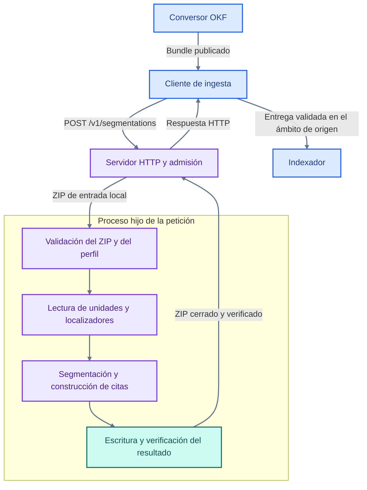

# Arquitectura técnica del microservicio de segmentación para RAG

**Diseño propuesto para el MVP · 19 de noviembre de 2026**

El segmentador se despliega como un servicio HTTP independiente y sin estado persistente. Una petición lleva un ZIP de OKF y recibe otro ZIP con fragmentos citables. La réplica conserva la entrada, los archivos de trabajo y la salida durante esa petición. El cliente de ingesta conserva el bundle que dará respaldo a las citas y entrega el resultado al indexador. [Especificación del segmentador](../especificacion/SEGMENTACION_PARA_RAG.md)

## 1. Unidad de despliegue y fronteras

Se propone una imagen con un ejecutable Rust en dos modos. El **servidor HTTP**, con Axum y Tokio, recibe y devuelve bytes, administra los cupos y supervisa los plazos. Un **proceso hijo por petición admitida** valida el documento, calcula los fragmentos y construye la respuesta. El coste de iniciar el hijo permite poner límites de memoria y CPU al análisis de un bundle y cancelar una petición sin interrumpir las demás. La conexión HTTP permanece abierta durante el procesamiento.

El cliente invoca el segmentador por `POST /v1/segmentations` con `application/zip`. Es la única operación de negocio del MVP. La integración utiliza el ZIP publicado por el conversor, de modo que cada servicio puede actualizarse por separado mientras se mantengan los contratos compatibles. La estrategia `estructura-1`, el esquema del perfil `1.24.0` y el vocabulario del tokenizador viajan con la imagen. La ejecución de una petición solo depende de recursos locales. [Contrato de entrada y salida](../especificacion/SEGMENTACION_PARA_RAG.md)

## 2. Recorrido de una petición

| Etapa | Componente y decisión |
| --- | --- |
| Admisión | El servidor comprueba el tipo de contenido y adquiere un cupo. Crea un directorio temporal privado con nombre interno. Copia el cuerpo por bloques, cuenta los bytes efectivamente recibidos y calcula `bundle_sha256` sobre esos mismos bytes. Un `Content-Length` anunciado permite un rechazo temprano. |
| Validación | Una vez cerrada la entrada, el supervisor inicia el hijo con acceso de lectura al ZIP y escritura únicamente en el área de trabajo de esa petición. El hijo comprueba el contenedor, identifica perfil y formato, valida el esquema y coteja las reglas del perfil con el original incluido. |
| Inventario | El lector resuelve el índice de `contenido/` y sus relaciones. Construye la lista ordenada de unidades y un mapa de rutas para consulta. Una región XLSX enlazada por el índice y por su hoja tiene una sola entrada. El orden físico del ZIP es irrelevante. |
| Segmentación | El lector abre una unidad cada vez. El adaptador del formato entrega bloques con evidencia de origen. El motor común aplica los límites, asigna ordinales y escribe los registros de `chunks.jsonl` en el orden de lectura. Al cerrar cada unidad registra recuentos y avisos, incluso si produjo cero fragmentos. |
| Entrega | El escritor completa `manifest.json`, copia los bytes originales de `conversion-report.md` y cierra el ZIP. Un verificador relee el resultado. Solo tras el éxito del hijo, el padre abre el archivo de salida acordado y responde `200` con su longitud. Conserva el archivo hasta que termine la transferencia o el cliente se desconecte. |

El hijo comunica al padre el éxito o una causa tipada por un canal local. La ruta de salida la fija el supervisor. El archivo en preparación queda privado, de manera que una validación tardía, un fallo de disco o un hijo interrumpido no pueden publicar una entrega incompleta. Si la conexión cae durante la descarga, el cliente descarta los bytes truncados y puede reenviar la misma entrada.

## 3. Validación del bundle y compatibilidad

La admisión del contenedor comprueba cantidad de entradas, rutas internas únicas, tamaños declarados y reales, expansión acumulada y CRC. El segmento inicial `/` de una referencia OKF designa la raíz lógica del bundle. Los archivos se resuelven en su catálogo de entradas y los enlaces externos se conservan como datos. El esquema se aplica al frontmatter leído como JSON y, en PDF, PPTX y DOCX, a los archivos declarados en `block_spans` mediante `$defs/blockSpansFile`. [Esquema del perfil 1.24.0](../especificacion/perfil-1.24.0.schema.json)

Para las reglas editoriales y de identidad se propone **empaquetar el validador del productor como biblioteca Rust versionada**, con una interfaz local que distinga archivo ilegible, límite, incompatibilidad, infracción del perfil y fallo operativo. La biblioteca conservaría las comprobaciones de la huella real del original, `settings_sha256`, `conversion_id`, `unit_id`, referencias, relaciones y localizadores. El segmento aceptado por este consumidor se fija explícitamente a OKF `0.2` y perfil `1.24.0`. Un perfil reconocido por el conversor puede seguir siendo incompatible con este MVP.

Esta biblioteca es una dependencia **por extraer**. Hoy el productor expone `okf-microservice validate` como comando, sus funciones son internas y la validación por JSON Schema se ejecuta en pruebas. La extracción permitiría compartir las reglas y clasificar los errores sin interpretar mensajes de consola. El esquema sí formaría parte de la validación en ejecución del segmentador. La paridad con el comando existente se comprobaría sobre los ZIP publicados por el productor. [Validador actual](../../src/validate.rs) · [Validación frente al original](../../src/bundle.rs) · [Uso actual del esquema](../../src/schema.rs)

En el ejecutable propuesto, `zip` leería el contenedor, `yaml_serde` leería el frontmatter, `jsonschema` comprobaría el esquema empacado y `sha2` calcularía las huellas. El informe se copiaría directamente desde su entrada ZIP para conservar también sus saltos de línea y su representación original. [Dependencias del productor que sustentan esta elección](../../Cargo.toml)

## 4. De los bloques a los fragmentos citables

El núcleo trabaja con dos representaciones internas. Una **unidad** conserva la ruta, el `unit_id`, los títulos, las relaciones y el catálogo de localizadores de un concepto. Un **bloque** conserva su clase editorial, canal, contexto y una secuencia de tramos de texto. Cada tramo distingue la evidencia con su localizador del texto de presentación, como el separador entre celdas. Los adaptadores producen estos bloques. Un único motor decide el corte y un único escritor serializa las citas de los cuatro formatos.

El lector Markdown reconoce encabezados, listas, tablas, citas, comentarios y código. Asocia cada marca `okf-source-span` u `okf-generated` al bloque que le corresponde antes de limpiar el texto. Un ejemplo de la marca dentro de código conserva sus caracteres literales. Se propone `pulldown-cmark` con tablas habilitadas. Sus eventos con posiciones facilitan volver al texto del Markdown durante el análisis. Las posiciones públicas de las citas se calculan posteriormente sobre el texto final. [Interfaz del analizador Markdown](https://docs.rs/pulldown-cmark/latest/pulldown_cmark/struct.Parser.html#method.into_offset_iter)

### Adaptadores de lectura

| Adaptador | Construcción de la evidencia |
| --- | --- |
| **PDF** | Al abrir el concepto, combina sus `source_spans` con los del archivo señalado por `block_spans`. Un bloque conserva su intervalo de páginas físicas y todas sus cajas. Si se parte el texto, cada parte conserva el localizador del bloque con su precisión original. Las señales de OCR o borrador mantienen el alcance que declara el productor. |
| **DOCX** | Al abrir el concepto, combina sus `source_spans` con los del archivo señalado por `block_spans`, que desde el perfil 1.24.0 contiene los `docx_blocks` de cada bloque. Conserva los intervalos `docx_blocks` de párrafos, tablas y listas. Relaciona notas con sus llamadas por tipo y número cuando la asociación es inequívoca. La vista final y las notas recorren canales distintos. Las secciones auxiliares de revisiones, comentarios y texto oculto producen avisos de exclusión. |
| **PPTX** | Al abrir el concepto, combina sus `source_spans` con los del archivo señalado por `block_spans`, que desde el perfil 1.24.0 contiene los `pptx_shape`. Usa `pptx_shape` en el bloque marcado y `pptx_slide` cuando la evidencia alcanza la diapositiva. Las notas del presentador abren el canal `speaker_notes`. La condición de diapositiva oculta se lee de la indicación editorial del productor antes de descartar las notas generadas. Cada diapositiva excluida conserva su entrada en el manifiesto. |
| **XLSX** | Procesa las regiones pequeñas del Markdown y, en una `Sheet Region` visible, recorre los registros del CSV completo. El número de registro y la esquina inicial del rango ubican la fila física incluso con filas vacías o valores multilínea. Cuando existe el JSONL, relaciona los registros por dirección de celda. El valor mostrado, la fórmula y el registro original conservan sus significados. La hoja padre aporta visibilidad y la muestra Markdown solo aporta navegación. Al abrir un concepto combina sus `source_spans` (`hoja` o `region`) con los del archivo señalado por `block_spans` (desde el perfil 1.24.0, las regiones en línea `r-<k>` y `muestra`). |

En XLSX, la asociación CSV–JSONL se limita a una región. Para evitar depender del orden del JSONL o retenerlo entero en memoria, el hijo puede almacenar los registros en una tabla SQLite temporal indexada por fila y columna, consultar una fila por vez y eliminar la tabla al cerrar la región. La tabla pertenece a la petición y queda cubierta por su presupuesto de disco. [Región de ejemplo con ambos recursos](../../examples/xlsx/esperado/muestras/ventas_trimestrales/contenido/hoja-002-region-01.md)

### Corte, citas y escritura

1. **Seleccionar.** El motor respeta unidad, subsección y canal. Agrupa la prosa contigua y conserva los límites propios de listas, tablas, código y filas de Excel. Los tramos sustantivos necesitan evidencia. Un localizador superior aplicable produce precisión `unit` y aviso `coarse_citation`. Un pasaje elegible sin evidencia aplicable produce `uncitable_text`. Una marca explícita cuyo destino está roto es un error de entrada.
2. **Medir el texto que recibirá el índice.** El motor normaliza saltos a LF, coloca los separadores y cuenta la cadena candidata completa. El presupuesto es de 512 tokens, con codificación ordinaria `cl100k_base`, también ante texto que se parezca a un token especial. Para Rust se propone `tiktoken-rs` con vocabulario local y pruebas de equivalencia frente a `tiktoken 0.9.0`. [Codificación ordinaria en Rust](https://docs.rs/tiktoken-rs/latest/tiktoken_rs/struct.CoreBPE.html#method.encode_ordinary) · [Definición de referencia](https://github.com/openai/tiktoken/blob/0.9.0/tiktoken_ext/openai_public.py)
3. **Partir y localizar.** Si un bloque rebasa el presupuesto, se prueban los límites de fila, elemento o línea según su tipo, y después los de espacio y carácter que establece la estrategia. Cada parte conserva sus tramos de evidencia. El escritor mide los bytes UTF-8 a medida que incorpora el texto definitivo y genera intervalos `[start_byte, end_byte)`. Si el corte atraviesa un tramo, se recorta el intervalo de texto y se conserva el localizador original. Los desplazamientos se calculan antes del escape JSON.
4. **Asignar identidad y verificar.** Se asigna el ordinal consecutivo dentro de la unidad y se deriva `chunk_id` del texto definitivo. `result_id` usa la estrategia y la huella exacta del ZIP. El verificador comprueba identidades, orden, recuentos por unidad, presupuesto de tokens, cobertura de los tramos sustantivos, límites UTF-8, resolución de citas y copia exacta del informe. Los avisos se emiten en orden de lectura. El criterio de repetibilidad es la igualdad del contenido lógico de la entrega. [Reglas de identidad y segmentación](../especificacion/SEGMENTACION_PARA_RAG.md)

**Ejemplo de extremo a extremo.** En la fila 250 de «Detalle», el adaptador asocia el valor `777.75` con la columna «Importe» y el registro de `F250`, cuya fórmula es `=D250*E250`. Al escribir las siete celdas de la fila en el formato de la estrategia, el valor ocupa los bytes `[140, 146)`. La cita conserva `span.id = region`, `cell_range = F250` y precisión `cell`. Así se puede buscar por el producto y la fecha de la fila y resaltar solo el importe en el original. [Valores de la región](../../examples/xlsx/esperado/muestras/ventas_trimestrales/assets/hoja-002-region-01.csv) · [Registro de la celda](../../examples/xlsx/esperado/muestras/ventas_trimestrales/assets/hoja-002-region-01-celdas.jsonl)

## 5. Capacidad, fallos y permisos

**Concurrencia y almacenamiento.** El despliegue inicial propone un cupo por réplica. El cupo se reserva antes de almacenar la subida y se libera después de limpiar el directorio, incluida la descarga. El disco temporal debe alojar la entrada comprimida, el resultado en preparación, los archivos intermedios y, cuando proceda, el índice de celdas. El cálculo de memoria debe incluir el original que el validador actual llega a cargar y la unidad en curso. El piloto medirá máximos por formato antes de aumentar los cupos. Las réplicas son independientes y pueden recibir un reintento en cualquier orden. [Lectura del original durante la validación](../../src/bundle.rs)

**Aislamiento y ciclo de vida.** El supervisor limita tiempo de subida, procesamiento y descarga, además de memoria, CPU y disco temporal. Para el despliegue Linux se propone una cuenta sin privilegios y un entorno mínimo para el hijo. Antes de abrir el ZIP se restringen los archivos accesibles con Landlock y se bloquean los sockets con seccomp. Solo se heredan los descriptores necesarios para la petición. El supervisor controla el proceso hasta su terminación, también al vencer el plazo o desconectarse el cliente. Al apagar una réplica se cierra la admisión y se concede un plazo a las peticiones activas. El área temporal es exclusiva de la réplica y se eliminan sus restos al arrancar antes de admitir tráfico. [Precedente de aislamiento en el conversor](ARQUITECTURA_TECNICA_MICROSERVICIO_OKF.md)

| Situación | Comportamiento visible |
| --- | --- |
| Tipo incorrecto o ZIP vacío o ilegible | `415 unsupported_media_type` o `400 invalid_archive` según la fase. |
| La entrada excede los límites publicados de bytes o de cantidad de entradas | `413 limit_exceeded`. Los límites de expansión se verifican sobre bytes leídos. |
| Perfil o formato incompatible, o bundle incoherente | `422` con `unsupported_profile`, `unsupported_format` o `invalid_bundle`. Un recurso obligatorio ausente impide la entrega. |
| Origen parcial o unidad sin texto | `200` con `source_status` conservado. `excluded_by_policy` y `no_text` explican ausencias previstas. Solo `uncitable_text` determina `segmentation_status: partial`. Con cero fragmentos se entregan el manifiesto, el informe y un `chunks.jsonl` vacío. |
| Capacidad agotada, espacio temporal insuficiente o interrupción transitoria antes de responder | `503 temporarily_unavailable`. Se descarta el artefacto en preparación. El cliente puede reenviar el ZIP. |

**Permisos y versiones.** El cliente autorizado establece el ámbito de origen fuera del ZIP. El segmentador propaga `document_key` y `access` al manifiesto y a cada fragmento cuando están presentes. Conserva los bytes UTF-8 de la cadena `access` decodificada. Si falta, corresponde al sistema de origen resolver la política antes de publicar. Dos peticiones pueden compartir `chunk_id` aunque pertenezcan a colecciones o políticas diferentes. El indexador asocia cada fragmento a `(ámbito de origen, result_id, chunk_id)` y activa la entrega como conjunto. El sistema de recuperación aplica las revocaciones incluso durante una reindexación. Si `reproducible` es `false`, la huella del ZIP sigue identificando el artefacto exacto.

**Observabilidad.** Registrar por petición el formato, el resultado HTTP, los bytes recibidos y entregados, las unidades y fragmentos, las causas de omisión y la duración de admisión, validación, segmentación y entrega. Para dimensionar las réplicas se miden además cupos ocupados, memoria máxima del hijo y máximo de disco temporal. Los registros usan un identificador operativo de petición. El texto, `access`, `document_key` y los identificadores de contenido se mantienen fuera de registros y etiquetas de métricas.

## 6. Verificación del diseño al implementar el MVP

| Prueba | Qué decisión comprueba |
| --- | --- |
| Contrato con el productor | Convertir los 32 ejemplos públicos y enviar sus ZIP reales por HTTP. Comparar la aceptación del perfil con el validador de referencia, resolver cada cita y verificar que las unidades excluidas o vacías también aparecen en el manifiesto. |
| Evidencia por formato | Verificar texto y caja de `u-2` en el informe PDF, el pasaje `b-7` en DOCX, la ecuación de la forma 4 en PPTX y las 300 filas de «Detalle» en XLSX. Incluir un bloque PDF de dos páginas, notas, contenido oculto y un CSV con saltos de línea entre comillas. |
| Cortes y determinismo | Comparar el tokenizador con la referencia en acentos, Unicode multibyte, código, celdas largas y secuencias especiales literales. Repetir en paralelo y comparar registros, orden y manifiestos. Reempaquetar el ZIP y comprobar por separado la identidad del resultado y la de los fragmentos. |
| Recuperación y aislamiento | Interrumpir una subida, terminar un hijo y cortar una descarga. Comprobar que se recuperan cupo y espacio, que el cliente puede reintentar y que dos peticiones con el mismo contenido y permisos distintos mantienen sus asociaciones. |
| Capacidad de la réplica | Medir, sobre los mismos bundles, tiempo por etapa, memoria, disco y tamaño de salida con una petición y con carga concurrente. Las mediciones fijarán los límites operativos del despliegue. |

Estas comprobaciones son criterios de la implementación futura. Los resultados esperados por formato y las reglas que determinan la aceptación funcional pertenecen a la [especificación del MVP](../especificacion/SEGMENTACION_PARA_RAG.md).
