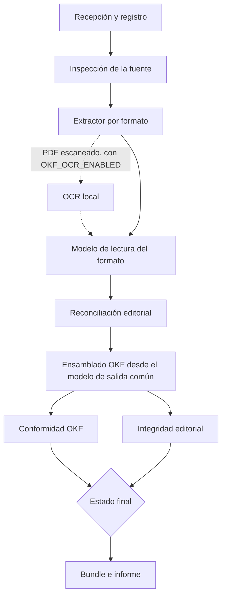

# Diagrama conceptual del microservicio de conversión a OKF

La recepción registra el trabajo y entrega su identificador. Un worker ejecuta las etapas posteriores de forma asíncrona. Las dos validaciones son independientes y determinan el estado del resultado. El OCR local es opcional: solo actúa sobre las páginas PDF escaneadas sin capa de texto, y su texto entra en el mismo modelo de lectura que el texto digital ([OCR local](../decisiones/OCR_LOCAL.md)).
