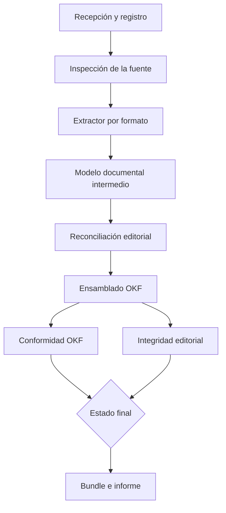

# Diagrama conceptual del microservicio de conversión a OKF

La recepción registra el trabajo y entrega su identificador. Un worker ejecuta las etapas posteriores de forma asíncrona. Las dos validaciones son independientes y determinan el estado del resultado.
