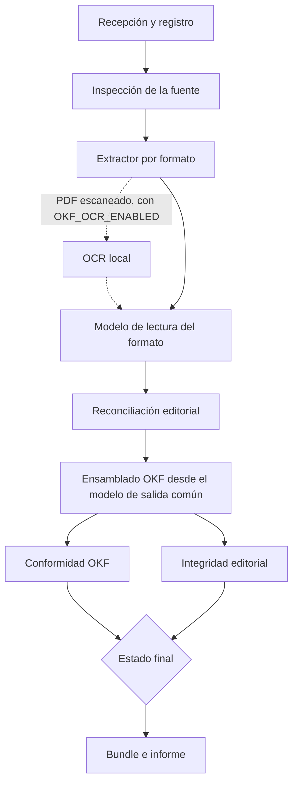
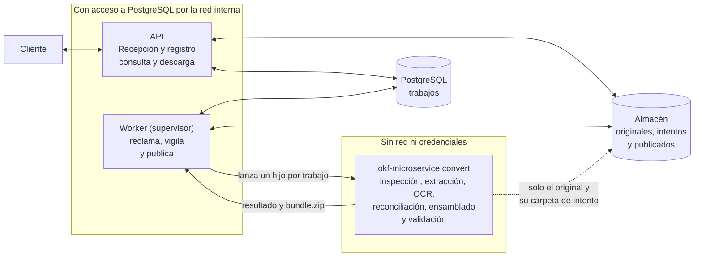

# Diagrama conceptual del microservicio de conversión a OKF

La recepción registra el trabajo y entrega su identificador. Un worker ejecuta las etapas posteriores de forma asíncrona. Las dos validaciones son independientes y determinan el estado del resultado. El OCR local es opcional: solo actúa sobre las páginas PDF escaneadas sin capa de texto, y su texto entra en el mismo modelo de lectura que el texto digital ([OCR local](../decisiones/OCR_LOCAL.md)).

## Procesos y frontera de aislamiento

Las etapas anteriores se reparten entre tres procesos. Solo el proceso de conversión abre el documento, y es el único sin red ni credenciales.

El detalle de esta frontera (qué la cruza, el orden de las capas, el motivo de cada una y las diferencias entre Linux y macOS) está en la [arquitectura técnica, Frontera del proceso de conversión](ARQUITECTURA_TECNICA_MICROSERVICIO_OKF.md#frontera-del-proceso-de-conversión-plan-2-c3-y-c4). La derivación de `conversion_id` y `unit_id`, y su diferencia con `job_id`, está en [Identificadores de la conversión y de sus unidades](ARQUITECTURA_TECNICA_MICROSERVICIO_OKF.md#identificadores-de-la-conversión-y-de-sus-unidades-plan-3-i1).
