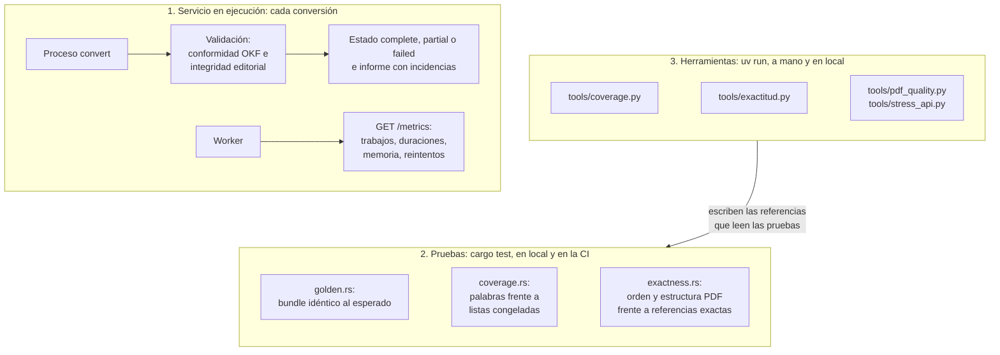
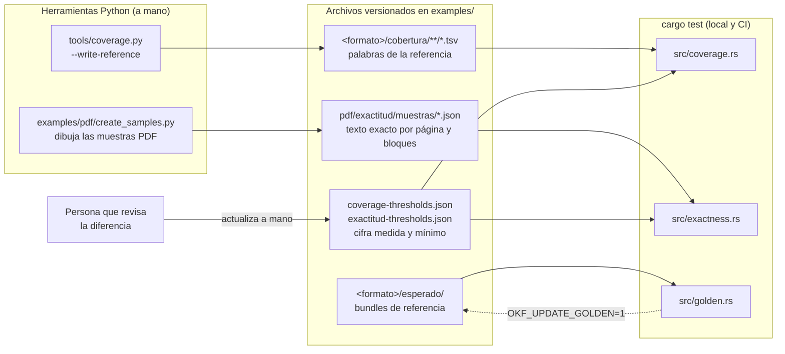
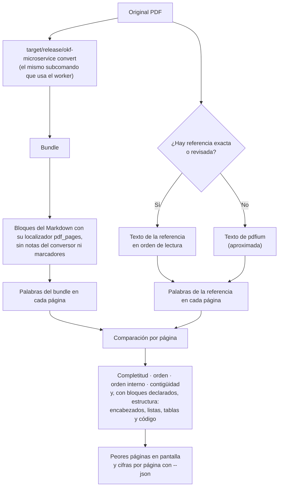

# Medición de la calidad del bundle

Este documento responde a tres preguntas de quien llega al repositorio: qué se comprueba de un bundle y dónde, por qué la medición de calidad está escrita en Python y si forma parte del servicio o solo de las pruebas. El método detallado de cada medición está en [Cobertura frente a una referencia independiente](COBERTURA_INDEPENDIENTE.md) y en [Exactitud del texto PDF](EXACTITUD_DEL_TEXTO.md).

**Respuesta corta.** El servicio en ejecución no mide la calidad del texto frente a una referencia: valida la coherencia del bundle y declara sus pérdidas. La comparación con una referencia independiente (cobertura y exactitud) se hace **fuera del servicio**: con herramientas en Python que se ejecutan a mano, y con pruebas en Rust que repiten el mismo cálculo en `cargo test` y en la CI, sin Python. Nada de esto se compila en el binario de producción ni entra en la imagen Docker.

## 1. Tres lugares, tres propósitos

| Lugar | Cuándo se ejecuta | Qué comprueba | Compara con una referencia externa | Necesita Python | Consecuencia |
| --- | --- | --- | --- | --- | --- |
| **Servicio** (`convert`, dentro del worker) | En cada conversión | Conformidad OKF e integridad editorial del bundle (§2) | No | No | Decide `complete`, `partial` o `failed` y escribe el informe |
| **Métricas operativas** (`GET /metrics`) | Siempre que el servicio está en marcha | Trabajos por estado, conversiones, duraciones por etapa, memoria máxima y reintentos | No | No | Observabilidad; no dicen nada de la calidad del texto |
| **Pruebas** (`cargo test --locked`) | Antes de cada commit y en la CI | Bundles de referencia (golden), cobertura y exactitud por debajo de su mínimo | Sí, a través de archivos congelados en `examples/` | No | Un fallo impide fusionar el cambio |
| **Herramientas** (`uv run tools/…`) | A mano, al cambiar un adaptador o medir un original | Cobertura y exactitud de cualquier documento, también privados; peores páginas; borradores de referencia; carga | Sí, en el momento (pdfium, `python-docx`, `python-pptx`, `openpyxl`) | Sí | Cifras y referencias que alguien revisa y, si procede, versiona |

Hay dos sentidos de «métricas» en el repositorio. Las de `GET /metrics` son **operativas** y forman parte del servicio ([arquitectura técnica, Salud y métricas](../arquitectura/ARQUITECTURA_TECNICA_MICROSERVICIO_OKF.md#salud-y-métricas-plan-2-c7)). Las de cobertura y exactitud son **de calidad** y solo existen en las pruebas y en las herramientas.

## 2. Qué se evalúa durante la ejecución, y qué no

En cada conversión, el proceso `convert` valida el bundle antes de entregarlo ([arquitectura técnica, Validación antes de publicar](../arquitectura/ARQUITECTURA_TECNICA_MICROSERVICIO_OKF.md#5-implementación-en-las-entregas-pptx-docx-xlsx-y-pdf) y [especificación, §6](../especificacion/ESPECIFICACION_OKF.md#6-informe-y-aceptación)):

- **Conformidad OKF:** frontmatter, tipos, índices, archivos reservados y enlaces.
- **Integridad editorial:** que todas las páginas, bloques, hojas o diapositivas del original estén localizadas en algún concepto y en orden; que cada marcador `okf-source-span` resuelva a su localizador; que las huellas del original coincidan; que todo recurso esté enlazado.

El servicio no tiene una «respuesta correcta» con la que comparar: no sabe qué texto debería haber salido, solo que lo que sale es coherente y que cada parte del original tiene un sitio en el bundle. Lo que no puede representar lo declara en el informe como incidencia (y entonces el estado es `partial`) u observación. Por eso `complete` significa «sin pérdidas detectadas ni declaradas», no «texto exacto»: un párrafo con las palabras en otro orden pasa la validación. Ese tipo de defecto solo lo detectan la cobertura y la exactitud, frente a una referencia.

## 3. Por qué la medición se hace en Python

**Independencia.** Una referencia construida con los lectores del propio servicio compartiría sus errores: si el lector PDF pierde una línea, la perdería también en la referencia y la medición daría 100 %. La referencia tiene que salir de código que no comparte nada con los lectores del servicio ([plan 1, R2](../planes/PLAN_1_RECUPERACION_DEL_PLAN_ORIGINAL.md#r2-referencia-de-cobertura-independiente-m)):

| Formato | El servicio lee con | La referencia lee con |
| --- | --- | --- |
| PDF | `pdf_oxide` y una maquetación propia | pdfium (`pypdfium2`) |
| DOCX | Lector OOXML propio | `python-docx` y el XML de las partes que no cubre |
| PPTX | Lector OOXML propio (`betteroffice-pptx` solo dibuja las vistas) | `python-pptx` y el XML de las partes que no cubre |
| XLSX | Lector OOXML propio | `openpyxl` (valores almacenados) y el XML de los gráficos |

Esas bibliotecas son las lecturas de referencia habituales de cada formato y están en Python.

**Fuera del servicio.** Cada script declara sus dependencias con versión fija en su cabecera (PEP 723) y `uv run` crea su entorno aislado. Ninguna entra en `Cargo.lock`, en la imagen Docker ni en el binario: la medición no puede cambiar lo que convierte el servicio.

**Mide lo que las pruebas no pueden.** Las herramientas miden documentos que no están en el repositorio (los originales privados de `datos_de_prueba/`), listan las peores páginas, guardan cifras en JSON y escriben borradores de referencia para revisarlos a mano.

**Su límite.** Las muestras sintéticas se generan con las mismas bibliotecas que sirven de referencia y solo contienen lo que esas bibliotecas saben escribir. Su cobertura no es evidencia independiente; la evidencia sale del corpus real ([cobertura, §3](COBERTURA_INDEPENDIENTE.md#3-muestras-sintéticas)).

## 4. Cómo llega la medición a la CI sin Python

Las herramientas Python **congelan** su referencia en archivos versionados. Las pruebas en Rust leen esos archivos y repiten el mismo cálculo, así que la CI no necesita Python ni pdfium.

- **Referencias de cobertura:** `tools/coverage.py --write-reference` guarda las palabras de la referencia de cada documento de `examples/` en `examples/<formato>/cobertura/<grupo>/<nombre>.tsv`.
- **Referencias de exactitud:** `examples/pdf/create_samples.py` escribe el texto exacto de cada página al dibujar cada PDF de muestra, en `examples/pdf/exactitud/muestras/`. Son correctas por construcción.
- **Umbrales:** `examples/coverage-thresholds.json` y `examples/exactitud-thresholds.json` guardan, por documento, la cifra medida y un mínimo medio punto por debajo. Se actualizan **a mano**, después de explicar la diferencia.
- **Pruebas:** `src/coverage.rs` y `src/exactness.rs` (compiladas solo con `#[cfg(test)]`) convierten cada documento con el mismo código que el servicio, cuentan las palabras igual que los scripts y fallan si una cifra queda por debajo de su mínimo.
- **Golden, aparte:** `src/golden.rs` compara cada bundle archivo por archivo con su bundle esperado. Regenerarlo con `OKF_UPDATE_GOLDEN=1` no toca las listas ni los umbrales, de modo que un cambio que pierde texto no puede «aprobarse» regenerando los golden.
- **Originales privados:** se miden solo en local. Sus listas y referencias revisadas no se versionan, y `p3.pdf` nunca entra al repositorio.

## 5. Cómo funciona `tools/exactitud.py`

La cobertura dice si una palabra llega al bundle; la exactitud, si llega en su sitio. `tools/exactitud.py` solo mide PDF y lo hace página por página.

1. **Convierte** el PDF con el ejecutable del servicio (`--binary` cambia cuál; por defecto el de `cargo build --release`), con la configuración del entorno. Si se pasa `--bundle`, mide ese ZIP en vez de convertir.
2. **Lee el bundle** por bloques, en el orden del Markdown, y asigna cada bloque a las páginas de su localizador. Las notas `<!-- okf-generated -->`, los rótulos, los marcadores y los destinos de enlaces no cuentan como texto del original.
3. **Elige la referencia:**
   - *exacta*, si existe `examples/pdf/exactitud/<grupo>/<nombre>.json` (muestras públicas);
   - *revisada*, si se pasa `--reference` (originales privados, revisados a mano);
   - *aproximada*, el texto de pdfium en los demás casos. pdfium sigue el flujo de contenido del PDF, no el orden de lectura, así que con ella el **orden** global no prueba un error; el **orden interno** y la **contigüidad** sí son significativos.
4. **Compara** página a página: completitud (palabras presentes), orden (subsecuencia común más larga), orden interno (lo mismo dentro de cada bloque) y contigüidad (pares de palabras vecinas que siguen juntas). Con una referencia que declara sus bloques mide también la estructura.
5. **Informa** las peores páginas con el primer tramo en que el bundle se aparta de la referencia, y con `--json` guarda las cifras de cada página.

Para un original privado sin referencia, `--draft DIR` escribe un **borrador** de las páginas difíciles, con su vista y una hoja de revisión. El borrador sale del propio bundle, así que no se mide con él hasta que una persona lo corrige mirando la vista y lo marca con `"reviewed": true`. Las métricas, sus fórmulas y las cifras actuales están en [Exactitud del texto PDF](EXACTITUD_DEL_TEXTO.md).

## 6. Qué usar en cada caso

| Situación | Qué ejecutar |
| --- | --- |
| Comprobar que un cambio no rompe nada | `cargo test --locked` (incluye golden, cobertura y exactitud) |
| Cambiar un adaptador | Además, `cargo build --release --locked` y `uv run tools/coverage.py` sobre los ejemplos; si cambia una cifra, explicarla o actualizar las listas con `--write-reference` y los umbrales a mano |
| Cambiar el adaptador PDF | Además, `uv run tools/exactitud.py examples/pdf/muestras/*.pdf` y, en local, los originales privados con `--reference` |
| Añadir un documento a `examples/` | Su lista de cobertura (`--write-reference`), su umbral en `coverage-thresholds.json` y su bundle esperado (`OKF_UPDATE_GOLDEN=1 cargo test golden`); si es una muestra PDF, también su referencia exacta y su umbral de exactitud |
| Auditar un PDF real y su bundle | `uv run tools/pdf_quality.py ORIGINAL.pdf bundle.zip` |
| Medir la API bajo carga | `python3 tools/stress_api.py`, contra una instancia de pruebas |

La CI programada usa Python para otra cosa: `tools/fuzz_seeds.py` prepara las semillas del fuzzing ([Fuzzing](FUZZING.md)). Tampoco forma parte del servicio.
